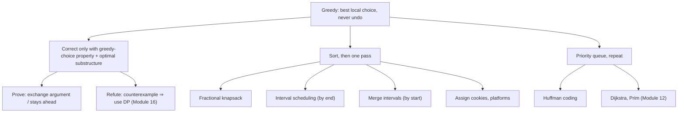

# Module 15 · Greedy Algorithms

Prepared by **Hamna Zahid Khan**, Junior Lecturer

[🏠 Course home](../README.md)

> ⏱ 6 contact hours · 2 sessions · 🔴 Advanced

Greedy algorithms build a solution one locally best choice at a time and never look back. When the problem has the right structure they are the fastest correct method; when it does not, they fail quietly. This module teaches both: how to design and prove greedy algorithms (exchange and stays-ahead arguments) and how to spot problems that need dynamic programming instead.

## 🎯 Module objectives

- Explain the greedy-choice property and optimal substructure.
- Prove greedy rules with exchange / stays-ahead arguments and refute bad rules with counterexamples.
- Solve coin change (canonical), fractional knapsack, jump game, gas station and platform problems.
- Build Huffman codes; solve interval scheduling, merging, arrows and removals.

## 📚 Sessions

| # | Session | Key ideas | Code |
|---|---|---|---|
| 1 | [Greedy Fundamentals](session-01-greedy-fundamentals.md) | greedy choice, exchange argument, coins, fractional vs 0/1 knapsack | [`GreedyFundamentals.java`](src/GreedyFundamentals.java) |
| 2 | [Huffman and Interval Scheduling](session-02-huffman-and-interval-scheduling.md) | prefix-free codes, Huffman tree, earliest finish, interval family | [`HuffmanIntervals.java`](src/HuffmanIntervals.java) |
| ✍️ | [Practice test](practice-test.md) | 20 MCQs + 3 coding scenarios | [`Labs15.java`](src/Labs15.java), [`SelfCheck.java`](src/SelfCheck.java) |

## 🗺️ Concept map



## 📄 One-page cheat sheet

| Problem | Greedy rule | Time | Optimal? |
|---|---|---|---|
| Coin change, canonical coins | largest coin first | O(k) | yes |
| Coin change, arbitrary coins | – | – | no → DP |
| Fractional knapsack | best value/weight | O(n log n) | yes |
| 0/1 knapsack | – | – | no → DP |
| Interval scheduling | earliest finish | O(n log n) | yes |
| Merge intervals | sort by start, extend | O(n log n) | yes |
| Min arrows / removals | sort by end | O(n log n) | yes |
| Huffman coding | merge two rarest | O(σ log σ) | yes (prefix-free codes) |
| Jump game / gas station | track reach / reset start | O(n) | yes |

**Interval selection template**

```java
Arrays.sort(iv, Comparator.comparingInt((int[] x) -> x[1]));   // by end
int count = 0; long lastEnd = Long.MIN_VALUE;
for (int[] x : iv) if (x[0] >= lastEnd) { count++; lastEnd = x[1]; }
```

**Proof tools:** exchange (swap greedy's choice into an optimal solution, no worse) · stays ahead (after each step greedy is at least as good).

## ▶️ Run the code

```bash
cd 15-greedy/src
javac -d out *.java
java -ea -cp out SelfCheck
java -cp out HuffmanIntervals
java -cp out Labs15 1          # Session 1 lab solutions (2 for Session 2)
```

See [`src/README.md`](src/README.md) for every file.
