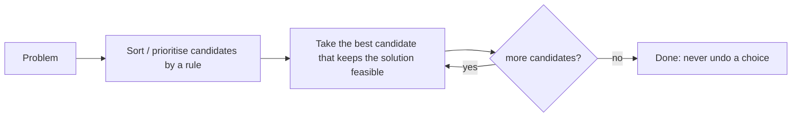

# Session 1 · Greedy Fundamentals

Prepared by **Hamna Zahid Khan**, Junior Lecturer

[🏠 Course home](../README.md) · [📘 Module overview](./README.md) · [⬅ Module overview](./README.md) · [Next ➡](./session-02-huffman-and-interval-scheduling.md)

> **Module 15 · Greedy Algorithms** · ⏱ 3 hours (90 min lecture + 90 min lab)

## 🎯 Learning objectives

1. Describe the greedy method: build a solution by repeatedly taking the **locally best** choice.
2. State the two properties that make greedy correct: the **greedy-choice property** and **optimal substructure**.
3. Prove (or disprove) a greedy rule with an **exchange argument** or a **counterexample**.
4. Solve coin change (canonical systems), fractional knapsack and matching problems greedily.
5. Recognise when greedy fails (0/1 knapsack, non-canonical coins) and dynamic programming is needed.

---

## 1. The greedy idea

A greedy algorithm makes one decision at a time, always the one that looks best **right now**, and never reconsiders it. No backtracking (Module 14), no table of subproblems (Module 16): just a sort or a priority queue and a single pass. That makes greedy algorithms fast, usually O(n log n), and short to write. The catch: **they are only correct for problems with the right structure.**

> 💵 **Analogy: a shopkeeper giving change.** To give Rs 188, the shopkeeper grabs the largest note that fits (100), then the largest that fits the rest (50), then 20, 10, 5, 2, 1. Seven pieces, and with Pakistani denominations that is always the minimum. But in a country with coins of 1, 3 and 4, the same habit gives 6 = 4 + 1 + 1 (three coins) when 3 + 3 (two coins) was possible.



## 2. When is greedy correct?

| Property | Meaning |
|---|---|
| **Greedy-choice property** | some optimal solution starts with the greedy choice |
| **Optimal substructure** | after making that choice, the rest of an optimal solution is an optimal solution of the smaller remaining problem |

If both hold, induction shows greedy is optimal. To **prove** a greedy rule, the standard tool is the **exchange argument**: take any optimal solution that disagrees with greedy, swap in the greedy choice, and show the result is no worse. To **disprove** a rule, one small counterexample is enough.

| Approach | Explores | Typical cost | Always optimal? |
|---|---|---|---|
| Brute force / backtracking | every candidate solution | exponential | yes |
| Dynamic programming | every subproblem once | polynomial (often) | yes, if subproblems are defined well |
| **Greedy** | one path | O(n log n) | **only with the greedy-choice property** |

## 3. Coin change

**Greedy rule:** repeatedly take the largest coin ≤ the remaining amount.

| Coin system | Greedy optimal? | Example |
|---|---|---|
| PKR 1, 2, 5, 10, 20, 50, 100 | yes (canonical) | 188 = 100 + 50 + 20 + 10 + 5 + 2 + 1 |
| US 1, 5, 10, 25 | yes | 30 = 25 + 5 |
| 1, 3, 4 | **no** | 6: greedy 4 + 1 + 1 (3 coins), optimal 3 + 3 (2 coins) |

The program checks the PKR system against an exact dynamic-programming answer for every amount up to 500 (`SelfCheck`) and shows the {1, 3, 4} failure. For arbitrary coin systems, coin change is solved by DP (Module 16).

## 4. Fractional knapsack

A truck carries 50 kg. Items have weight and value, and items **can be split** (rice, lentils, oil by the kilogram). Maximise value.

**Greedy rule:** sort by **value per kg** (ratio) and fill the truck from the best ratio down, splitting the last item.

| Item | Weight | Value | Ratio | Take | Value gained |
|---|---|---|---|---|---|
| tea | 5 | 50 | 10.0 | 5 kg | 50 |
| rice | 10 | 60 | 6.0 | 10 kg | 60 |
| lentils | 20 | 100 | 5.0 | 20 kg | 100 |
| oil | 30 | 120 | 4.0 | **15 of 30 kg** | 60 |
| total | | | | 50 kg | **270** |

**Exchange argument.** Suppose an optimal load carries 1 kg of a lower-ratio item while some higher-ratio item is not fully taken. Swap that kilogram for the higher-ratio one: the weight is unchanged and the value does not decrease. Repeating the swap turns any optimal load into the greedy load, so greedy is optimal.

## 5. When greedy fails: 0/1 knapsack

If items **cannot be split** (a laptop, a projector), the ratio rule breaks:

| Items (capacity 50) | Greedy by ratio | Optimal |
|---|---|---|
| A 10 kg / 60, B 20 kg / 100, C 30 kg / 120 | A + B = **160** (C no longer fits) | B + C = **220** |

Taking the best ratio first leaves awkward leftover capacity. The exchange argument fails because you cannot swap "1 kg" of an indivisible item. The 0/1 knapsack needs DP (Module 16).

## 6. Matching greedily: assign cookies

Children have greed factors, cookies have sizes; a child is happy with a cookie at least as big as their greed. Maximise happy children (each gets at most one cookie).

**Greedy rule:** sort both; give each cookie, smallest first, to the least greedy unsatisfied child it can satisfy. A cookie too small for the least greedy child is useless for everyone, so it is skipped.

| Greed (sorted) | Cookies (sorted) | Matches |
|---|---|---|
| 1, 2, 3, 4 | 2, 2, 5 | 2→1, 2→2, 5→3 ⇒ **3** |

## 7. Complexity table

| Problem | Greedy rule | Time | Optimal? |
|---|---|---|---|
| Coin change (canonical system) | largest coin first | O(number of coins used) | yes |
| Coin change (any system) | largest coin first | – | **no** → DP |
| Fractional knapsack | best value/weight first | O(n log n) | yes |
| 0/1 knapsack | best ratio first | O(n log n) | **no** → DP O(nW) |
| Assign cookies | smallest sufficient cookie | O(n log n + m log m) | yes |
| Jump game (reachability) | track farthest reach | O(n) | yes |

---

## 8. Complete program

📄 **[`src/GreedyFundamentals.java`](src/GreedyFundamentals.java)**

```java
import java.util.ArrayList;
import java.util.Arrays;
import java.util.Comparator;
import java.util.List;

/**
 * Session 1 demo: the greedy method. Coin change with canonical and non-canonical coin systems
 * (greedy vs optimal), fractional knapsack (greedy is optimal) vs 0/1 knapsack (greedy fails),
 * and the "assign cookies" matching problem.
 *
 * Compile:  javac -d out GreedyFundamentals.java
 * Run:      java -cp out GreedyFundamentals
 *
 * Prepared by Hamna Zahid Khan, Junior Lecturer
 */
public class GreedyFundamentals {

    /** Greedy change: always take the largest coin that fits. Returns the coins used. */
    static List<Integer> greedyChange(int[] coinsDesc, int amount) {
        List<Integer> used = new ArrayList<>();
        for (int c : coinsDesc)
            while (amount >= c) { used.add(c); amount -= c; }
        return amount == 0 ? used : null;
    }

    /** Optimal number of coins by dynamic programming (Module 16 preview), for comparison. */
    static int optimalCoins(int[] coins, int amount) {
        int[] best = new int[amount + 1];
        Arrays.fill(best, Integer.MAX_VALUE);
        best[0] = 0;
        for (int a = 1; a <= amount; a++)
            for (int c : coins)
                if (c <= a && best[a - c] != Integer.MAX_VALUE) best[a] = Math.min(best[a], best[a - c] + 1);
        return best[amount];
    }

    record Item(String name, int weight, int value) {
        double ratio() { return (double) value / weight; }
    }

    /** Fractional knapsack: take items by value/weight ratio; split the last one. O(n log n). */
    static double fractionalKnapsack(List<Item> items, int capacity, List<String> log) {
        List<Item> sorted = new ArrayList<>(items);
        sorted.sort(Comparator.comparingDouble(Item::ratio).reversed());
        double total = 0;
        int left = capacity;
        for (Item it : sorted) {
            if (left == 0) break;
            int take = Math.min(left, it.weight());
            total += take * it.ratio();
            left -= take;
            if (log != null) log.add(String.format("%-8s ratio %.2f take %d/%d kg -> +%.1f", it.name(), it.ratio(), take, it.weight(), take * it.ratio()));
        }
        return total;
    }

    /** 0/1 knapsack: greedy by ratio (may be wrong) vs exact DP over capacity. */
    static int greedyZeroOne(List<Item> items, int capacity) {
        List<Item> sorted = new ArrayList<>(items);
        sorted.sort(Comparator.comparingDouble(Item::ratio).reversed());
        int value = 0, left = capacity;
        for (Item it : sorted) if (it.weight() <= left) { value += it.value(); left -= it.weight(); }
        return value;
    }

    static int exactZeroOne(List<Item> items, int capacity) {
        int[] dp = new int[capacity + 1];
        for (Item it : items)
            for (int c = capacity; c >= it.weight(); c--) dp[c] = Math.max(dp[c], dp[c - it.weight()] + it.value());
        return dp[capacity];
    }

    /** Assign cookies: smallest cookie that satisfies the least greedy child first. Two pointers after sorting. */
    static int assignCookies(int[] greed, int[] cookies) {
        int[] g = greed.clone(), s = cookies.clone();
        Arrays.sort(g);
        Arrays.sort(s);
        int child = 0;
        for (int i = 0; i < s.length && child < g.length; i++)
            if (s[i] >= g[child]) child++;               // this cookie satisfies the current child
        return child;
    }

    public static void main(String[] args) {
        System.out.println("== Coin change with Pakistani coins and notes (1, 2, 5, 10, 20, 50, 100) ==");
        int[] pkr = {100, 50, 20, 10, 5, 2, 1};
        for (int amt : new int[]{37, 188, 99}) {
            List<Integer> g = greedyChange(pkr, amt);
            System.out.println("Rs " + amt + ": greedy " + g + " = " + g.size() + " pieces, optimal = " + optimalCoins(pkr, amt));
        }

        System.out.println("\n== A coin system where greedy fails: {1, 3, 4} ==");
        int[] odd = {4, 3, 1};
        for (int amt : new int[]{6, 10}) {
            List<Integer> g = greedyChange(odd, amt);
            System.out.println("amount " + amt + ": greedy " + g + " = " + g.size() + " coins, optimal = " + optimalCoins(odd, amt) + " coins");
        }

        System.out.println("\n== Fractional knapsack: a 50 kg relief truck ==");
        List<Item> goods = List.of(new Item("rice", 10, 60), new Item("lentils", 20, 100),
                new Item("oil", 30, 120), new Item("tea", 5, 50));
        List<String> log = new ArrayList<>();
        double best = fractionalKnapsack(goods, 50, log);
        for (String line : log) System.out.println("  " + line);
        System.out.printf("  total value = %.1f%n", best);

        System.out.println("\n== Same goods, but items cannot be split (0/1 knapsack) ==");
        System.out.println("greedy by ratio = " + greedyZeroOne(goods, 50) + ", exact (DP) = " + exactZeroOne(goods, 50));
        List<Item> trap = List.of(new Item("A", 10, 60), new Item("B", 20, 100), new Item("C", 30, 120));
        System.out.println("classic trap (cap 50): greedy = " + greedyZeroOne(trap, 50) + ", exact = " + exactZeroOne(trap, 50));

        System.out.println("\n== Assign cookies ==");
        System.out.println("greed [1, 2, 3], cookies [1, 1] -> " + assignCookies(new int[]{1, 2, 3}, new int[]{1, 1}) + " happy child");
        System.out.println("greed [1, 2], cookies [1, 2, 3] -> " + assignCookies(new int[]{1, 2}, new int[]{1, 2, 3}) + " happy children");
        System.out.println("greed [3, 1, 4, 2], cookies [2, 2, 5] -> " + assignCookies(new int[]{3, 1, 4, 2}, new int[]{2, 2, 5}) + " happy children");
    }
}
```

**Real output:**

```text
$ java -cp out GreedyFundamentals
== Coin change with Pakistani coins and notes (1, 2, 5, 10, 20, 50, 100) ==
Rs 37: greedy [20, 10, 5, 2] = 4 pieces, optimal = 4
Rs 188: greedy [100, 50, 20, 10, 5, 2, 1] = 7 pieces, optimal = 7
Rs 99: greedy [50, 20, 20, 5, 2, 2] = 6 pieces, optimal = 6

== A coin system where greedy fails: {1, 3, 4} ==
amount 6: greedy [4, 1, 1] = 3 coins, optimal = 2 coins
amount 10: greedy [4, 4, 1, 1] = 4 coins, optimal = 3 coins

== Fractional knapsack: a 50 kg relief truck ==
  tea      ratio 10.00 take 5/5 kg -> +50.0
  rice     ratio 6.00 take 10/10 kg -> +60.0
  lentils  ratio 5.00 take 20/20 kg -> +100.0
  oil      ratio 4.00 take 15/30 kg -> +60.0
  total value = 270.0

== Same goods, but items cannot be split (0/1 knapsack) ==
greedy by ratio = 210, exact (DP) = 230
classic trap (cap 50): greedy = 160, exact = 220

== Assign cookies ==
greed [1, 2, 3], cookies [1, 1] -> 1 happy child
greed [1, 2], cookies [1, 2, 3] -> 2 happy children
greed [3, 1, 4, 2], cookies [2, 2, 5] -> 3 happy children
```

---

## 9. Worked examples (basic → advanced)

**Example 1 (basic): jump game.** a[i] is the maximum jump from index i. Can you reach the end? Keep the **farthest** index reachable so far; if the loop ever reaches an index beyond it, you are stuck. For the **minimum** number of jumps, jump only when you reach the end of the current reach, choosing the best reach seen so far.

```java
/** Can you reach the last index? a[i] = maximum jump from i. Track the farthest reachable index. */
static boolean canReach(int[] a) {
    int far = 0;
    for (int i = 0; i < a.length; i++) {
        if (i > far) return false;                  // stuck before reaching i
        far = Math.max(far, i + a[i]);
    }
    return true;
}

/** Minimum number of jumps (reachable input): BFS by "levels" of reach. */
static int minJumps(int[] a) {
    int jumps = 0, curEnd = 0, far = 0;
    for (int i = 0; i < a.length - 1; i++) {
        far = Math.max(far, i + a[i]);
        if (i == curEnd) { jumps++; curEnd = far; }  // must jump: choose the best reach so far
    }
    return jumps;
}
```
<sub>Full, compiled version: [`src/Labs15.java`](src/Labs15.java)</sub>

| i | a[i] | far | jumps (minJumps) |
|---|---|---|---|
| 0 | 2 | 2 | 1 (curEnd = 2) |
| 1 | 3 | 4 | 1 |
| 2 | 1 | 4 | 2 (curEnd = 4) |
| 3 | 1 | 4 | 2 ⇒ end reached |

**Example 2 (intermediate): gas station.** A circular route with gas[i] at station i and cost[i] to reach the next. If the total gas ≥ total cost a solution exists; whenever the running tank goes negative at i, **no station from the current start to i can be the start**, so restart at i + 1.

```java
/** Start index to drive around a circular route, or -1. If the tank goes negative, start after that point. */
static int gasStation(int[] gas, int[] cost) {
    int total = 0, tank = 0, start = 0;
    for (int i = 0; i < gas.length; i++) {
        int d = gas[i] - cost[i];
        total += d;
        tank += d;
        if (tank < 0) { start = i + 1; tank = 0; }  // no start in [start..i] can work
    }
    return total >= 0 ? start : -1;
}
```
<sub>Full, compiled version: [`src/Labs15.java`](src/Labs15.java)</sub>

gas [1, 2, 3, 4, 5], cost [3, 4, 5, 1, 2] → start at station **3**.

**Example 3 (advanced): minimum railway platforms.** Sort arrival and departure times separately and sweep: an arrival before the next departure needs one more platform. The maximum count is the answer.

```java
/** Minimum railway platforms: sweep arrivals and departures in time order. */
static int minPlatforms(int[] arr, int[] dep) {
    int[] a = arr.clone(), d = dep.clone();
    Arrays.sort(a);
    Arrays.sort(d);
    int i = 0, j = 0, cur = 0, best = 0;
    while (i < a.length) {
        if (a[i] <= d[j]) { cur++; i++; best = Math.max(best, cur); }   // a train arrives before the next leaves
        else { cur--; j++; }
    }
    return best;
}
```
<sub>Full, compiled version: [`src/Labs15.java`](src/Labs15.java)</sub>

Arrivals 9:00, 9:40, 9:50, 11:00, 15:00, 18:00 and departures 9:10, 12:00, 11:20, 11:30, 19:00, 20:00 need **3** platforms (between 11:00 and 11:20).

## 10. Real-life problem: loading a flood-relief truck

**Problem.** A relief organisation sends a truck with 2 tonnes of capacity to a flood-hit area. Warehouse stock includes flour, rice, lentils, cooking oil and medicines, each with a "relief value per kg" set by field teams, and every bulk good can be loaded by the kilogram.

**Solution.** This is the fractional knapsack: sort goods by relief value per kg and load from the top, splitting the last good to fill exactly 2 tonnes. O(n log n) with a handful of goods, and provably optimal by the exchange argument. If some items are indivisible kits (tents, water filters), the problem becomes 0/1 knapsack for those items; the team should then use the DP from Module 16 for the kits and greedy for the bulk goods with the remaining capacity.

## 11. Common mistakes

| Mistake | Fix |
|---|---|
| Assuming greedy works because it worked on the examples | look for a counterexample; prove with an exchange argument |
| Using ratio-greedy on 0/1 knapsack | DP |
| Using largest-coin-first for arbitrary coin systems | DP, unless the system is known to be canonical |
| Sorting by the wrong key (e.g. value instead of value/weight) | the key **is** the algorithm: justify it |
| Integer division in ratios | use `double` or compare cross-products `v1 * w2` vs `v2 * w1` |
| Forgetting the feasibility check before taking a candidate | greedy still must respect constraints |

## 12. Best practices

- State the greedy rule in one sentence before coding: "always take the … first".
- Try to break it on 3-4 tiny inputs; compare with a brute force or DP (as `SelfCheck` does).
- Most greedy algorithms are "sort, then one pass" or "priority queue, then repeat": reach for those tools.
- Write a short exchange-argument proof in comments for any greedy rule you rely on.

---

## 13. Lab tasks

**Lab 1.1: Jump game** (reachability and minimum jumps).

<details>
<summary>✅ Solution</summary>

See Example 1.

</details>

**Lab 1.2: Gas station.**

<details>
<summary>✅ Solution</summary>

See Example 2.

</details>

**Lab 1.3: Minimum platforms.**

<details>
<summary>✅ Solution</summary>

See Example 3.

</details>

**Lab 1.4: Break a greedy rule.** For the 0/1 knapsack, try three greedy rules: highest value first, lightest first, best ratio first. Find a small input where each one fails.

<details>
<summary>✅ Solution</summary>

Capacity 50. **Highest value first:** items (50 kg, 100), (25 kg, 60), (25 kg, 60) → greedy 100, optimal 120. **Lightest first:** (10 kg, 10), (40 kg, 200) with capacity 40 → greedy 10, optimal 200. **Best ratio:** A/B/C trap above → greedy 160, optimal 220. No simple sort order solves 0/1 knapsack.

</details>

**Real output of the Session 1 lab solutions:**

```text
$ java -cp out Labs15 1
-- Session 1 labs --
canReach([2, 3, 1, 1, 4]) = true, canReach([3, 2, 1, 0, 4]) = false, minJumps([2, 3, 1, 1, 4]) = 2
gasStation(gas [1,2,3,4,5], cost [3,4,5,1,2]) = 3
minPlatforms = 3
```

---

## 14. Quiz

**Q1.** A greedy algorithm:

- **A.** explores every possible solution
- **B.** makes the locally best choice and never revisits it
- **C.** stores solutions to all subproblems
- **D.** always finds the optimum

**Q2.** Greedy coin change fails for coins {1, 3, 4} and amount:

- **A.** 4
- **B.** 5
- **C.** 6
- **D.** 7

**Q3.** Fractional knapsack is solved optimally by sorting items by:

- **A.** weight ascending
- **B.** value descending
- **C.** value per unit weight descending
- **D.** name

**Q4.** Why does ratio-greedy fail for 0/1 knapsack?

- **A.** ratios can be equal
- **B.** items cannot be split, so leftover capacity may be wasted
- **C.** sorting is too slow
- **D.** values are integers

**Q5.** An exchange argument proves greedy correct by:

- **A.** trying all inputs
- **B.** transforming any optimal solution into the greedy one without making it worse
- **C.** running the algorithm twice
- **D.** measuring time complexity

<details>
<summary><b>Show answers</b></summary>

1. **B**: Fast, but correct only with the greedy-choice property.
2. **C**: Greedy 4+1+1, optimal 3+3.
3. **C**: Exchange argument on 1 kg at a time.
4. **B**: The A/B/C example.
5. **B**: The standard proof technique.

</details>

---

## 15. Summary

- Greedy = sort or prioritise, then take the best feasible choice repeatedly; typically O(n log n).
- It is correct only with the **greedy-choice property** and **optimal substructure**; prove with exchange arguments, refute with counterexamples.
- Optimal greedy: canonical coin change, fractional knapsack, assign cookies, jump game, gas station, platforms.
- Not greedy: 0/1 knapsack, arbitrary coin systems → dynamic programming.

## 16. Viva / interview questions

1. What is the difference between greedy and dynamic programming?
2. Give an exchange-argument proof for the assign-cookies algorithm.
3. How can you test whether a coin system is canonical?
4. Why is the gas-station restart rule correct?
5. Show that "highest value first" fails for fractional knapsack too.
6. Name three greedy algorithms from earlier modules. (Dijkstra, Prim, Kruskal, Huffman…)

---

[⬅ Module overview](./README.md) · [📘 Module overview](./README.md) · [Next ➡](./session-02-huffman-and-interval-scheduling.md)
