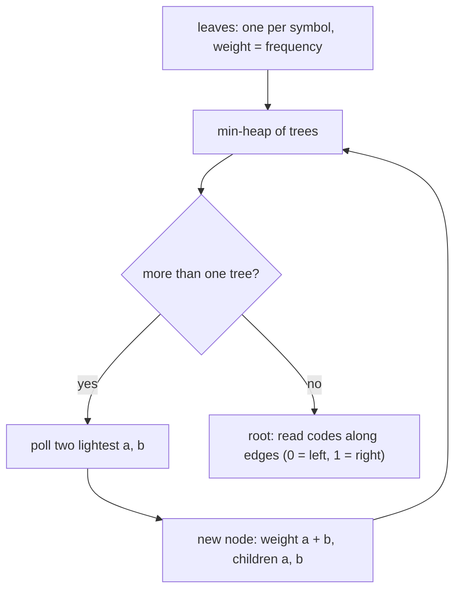

# Session 2 · Huffman Coding and Interval Scheduling

Prepared by **Hamna Zahid Khan**, Junior Lecturer

[🏠 Course home](../README.md) · [📘 Module overview](./README.md) · [⬅ Previous](./session-01-greedy-fundamentals.md) · [Practice test ➡](./practice-test.md)

> **Module 15 · Greedy Algorithms** · ⏱ 3 hours (90 min lecture + 90 min lab)

## 🎯 Learning objectives

1. Explain **prefix-free codes** and why variable-length codes compress data.
2. Build a **Huffman tree** with a priority queue, derive codes, encode and decode.
3. Solve **interval scheduling** optimally with the **earliest-finish-time** rule and prove it.
4. Show with counterexamples why "shortest first" and "earliest start" fail.
5. Apply interval greedy patterns: merging intervals, minimum arrows, minimum removals.

---

## Part A · Huffman coding

## 1. Variable-length, prefix-free codes

ASCII spends 8 bits on every character. If some characters are far more common (in English, 'e' and space; in our sample, 'a'), giving them **shorter** codes saves space.

The danger: with codes a = 0, b = 01, the bit string "01" could be "ab"… or "b". A code is **prefix-free** when no codeword is the prefix of another; then decoding is unambiguous: read bits until they match a codeword, output it, start again.

> 📻 **Analogy: Morse-style shorthand for a busy radio channel.** The most frequent words ("over", "copy") get the shortest signals and rare words the longest, so messages take less airtime. Huffman coding finds the **best possible** such assignment, with the guarantee that no signal is the start of another.

A prefix-free code is a binary tree: left edge = 0, right edge = 1, symbols at the **leaves**. A symbol's code length is its leaf depth, and the total cost is Σ freq(c) × depth(c).

## 2. Huffman's greedy algorithm (1952)

1. Make one leaf per symbol, weighted by frequency; put them in a **min-priority queue** (Module 11).
2. Repeatedly remove the **two lightest** trees and join them under a new parent whose weight is their sum.
3. When one tree remains, it is the optimal code tree.



**Why greedy works.** The two rarest symbols can always be placed as sibling leaves at the deepest level of some optimal tree (exchange argument: swapping a rarer symbol deeper never increases the cost). Merging them reduces the problem to n − 1 symbols with the same structure, so induction completes the proof.

### Dry run: "abracadabra alakazam" (20 characters)

Frequencies: a 9, b 2, r 2, and 1 each for space, c, d, k, l, m, z.

| Step | Merge (two lightest) | New weight |
|---|---|---|
| 1 | ' ' 1 + c 1 | 2 |
| 2 | d 1 + k 1 | 2 |
| 3 | l 1 + m 1 | 2 |
| 4 | z 1 + b 2 | 3 |
| 5 | r 2 + (2) | 4 |
| 6 | (2) + (2) | 4 |
| 7 | (3) + (4) | 7 |
| 8 | (4) + (7) | 11 |
| 9 | a 9 + (11) | 20 (root) |

Result: **a = 0** (1 bit, used 9 times), the rare letters get 4-5 bits. The whole text needs **55 bits** instead of 160 in ASCII (66% smaller) or 80 with a fixed 4-bit code for 10 symbols.

| Encoding | Bits for the sample |
|---|---|
| 8-bit ASCII | 160 |
| fixed length, ⌈log₂ 10⌉ = 4 bits | 80 |
| **Huffman** | **55** |

Huffman coding is a stage inside ZIP/DEFLATE, gzip, JPEG and MP3.

---

## Part B · Interval scheduling

## 3. The problem

One seminar hall, many talk requests [start, end). Accept the **maximum number** of non-overlapping talks.

> 🏛️ **Analogy: booking the seminar hall.** If you always approve the request that **frees the hall earliest**, you leave as much of the day as possible for everyone else.

| Greedy rule | Result on the program's 8 requests | Correct? |
|---|---|---|
| shortest talk first | 5 talks here, but fails on [0,5), [4,6), [5,10) (picks only the short middle one) | ✘ |
| earliest start first | only the all-day Keynote | ✘ |
| fewest conflicts first | fails on special constructions | ✘ |
| **earliest finish first** | 5 talks: Git, Java, AI, Ethics, Careers | ✔ always |

### Earliest-finish-time algorithm

```java
sort talks by end time;
lastEnd = −∞;
for (Talk t : talks)
    if (t.start >= lastEnd) { take t; lastEnd = t.end; }
```

**Proof (stays ahead).** Let greedy pick g₁, g₂, … and an optimal schedule pick o₁, o₂, … (both sorted by end). Since g₁ finishes earliest of all talks, end(g₁) ≤ end(o₁). Inductively, if end(gᵢ) ≤ end(oᵢ), then oᵢ₊₁ starts after end(oᵢ) ≥ end(gᵢ), so oᵢ₊₁ was available to greedy, which chooses something ending no later. Greedy is never behind, so it picks at least as many talks.

### Dry run (sorted by end)

| Talk | [start, end) | start ≥ lastEnd? | lastEnd |
|---|---|---|---|
| Git | [9, 10) | yes | 10 |
| Java | [10, 12) | yes | 12 |
| Cloud | [11, 13) | no | 12 |
| AI | [12, 14) | yes | 14 |
| Ethics | [14, 15) | yes | 15 |
| Security | [13, 16) | no | 15 |
| Keynote | [9, 17) | no | 15 |
| Careers | [15, 17) | yes | 17 |

## 4. The interval family

| Problem | Greedy key | Idea |
|---|---|---|
| Max non-overlapping intervals | end time | take if start ≥ last end |
| Min removals to make non-overlapping | end time | n − (max non-overlapping) |
| Min arrows / points hitting all intervals | end time | shoot at the end of the first unhit interval |
| Merge overlapping intervals | start time | extend the last merged interval |
| Min rooms / platforms (Module 11) | start time + heap of ends | reuse the earliest-freed room |

## 5. Complexity table

| Algorithm | Time | Space |
|---|---|---|
| Huffman coding, σ distinct symbols | O(σ log σ) to build + O(n) to count/encode | O(σ) tree |
| Huffman decoding of m bits | O(m) | O(1) extra |
| Interval scheduling | O(n log n) (sorting) | O(1) extra |
| Merge intervals / arrows / removals | O(n log n) | O(n) output |

---

## 6. Complete program

📄 **[`src/HuffmanIntervals.java`](src/HuffmanIntervals.java)**

```java
import java.util.ArrayList;
import java.util.Arrays;
import java.util.Comparator;
import java.util.List;
import java.util.Map;
import java.util.PriorityQueue;
import java.util.TreeMap;

/**
 * Session 2 demo: Huffman coding (build the tree with a priority queue, derive prefix-free codes,
 * encode, decode and measure compression) and interval scheduling (earliest-finish-time selection,
 * and why other greedy rules fail).
 *
 * Compile:  javac -d out HuffmanIntervals.java
 * Run:      java -cp out HuffmanIntervals
 *
 * Prepared by Hamna Zahid Khan, Junior Lecturer
 */
public class HuffmanIntervals {

    // ---------------- Huffman coding ----------------
    static final class Node {
        final char ch;            // meaningful only for leaves
        final int freq;
        final Node left, right;
        final int order;          // tie-breaker so the tree is deterministic
        Node(char ch, int freq, Node l, Node r, int order) { this.ch = ch; this.freq = freq; left = l; right = r; this.order = order; }
        boolean isLeaf() { return left == null; }
    }

    static Node buildTree(Map<Character, Integer> freq, List<String> log) {
        PriorityQueue<Node> pq = new PriorityQueue<>(Comparator.comparingInt((Node n) -> n.freq).thenComparingInt(n -> n.order));
        int order = 0;
        for (Map.Entry<Character, Integer> e : freq.entrySet()) pq.offer(new Node(e.getKey(), e.getValue(), null, null, order++));
        if (pq.size() == 1) {                                    // one distinct symbol: give it code "0"
            Node only = pq.poll();
            return new Node('\0', only.freq, only, null, order);
        }
        while (pq.size() > 1) {
            Node a = pq.poll(), b = pq.poll();                   // the two rarest subtrees
            Node parent = new Node('\0', a.freq + b.freq, a, b, order++);
            if (log != null) log.add("merge " + label(a) + " + " + label(b) + " -> " + parent.freq);
            pq.offer(parent);
        }
        return pq.poll();
    }

    static String label(Node n) { return n.isLeaf() ? "'" + n.ch + "':" + n.freq : "(" + n.freq + ")"; }

    static void codes(Node n, String prefix, Map<Character, String> out) {
        if (n == null) return;
        if (n.isLeaf()) { out.put(n.ch, prefix.isEmpty() ? "0" : prefix); return; }
        codes(n.left, prefix + "0", out);                        // left edge = 0
        codes(n.right, prefix + "1", out);                       // right edge = 1
    }

    static String encode(String s, Map<Character, String> code) {
        StringBuilder sb = new StringBuilder();
        for (char c : s.toCharArray()) sb.append(code.get(c));
        return sb.toString();
    }

    static String decode(String bits, Node root) {
        StringBuilder sb = new StringBuilder();
        Node n = root;
        for (char b : bits.toCharArray()) {
            n = b == '0' ? n.left : n.right;
            if (n.isLeaf()) { sb.append(n.ch); n = root; }        // prefix-free: a leaf ends a symbol
        }
        return sb.toString();
    }

    static Map<Character, Integer> frequencies(String s) {
        Map<Character, Integer> f = new TreeMap<>();
        for (char c : s.toCharArray()) f.merge(c, 1, Integer::sum);
        return f;
    }

    // ---------------- Interval scheduling ----------------
    record Talk(String name, int start, int end) { }

    /** Maximum number of non-overlapping talks using a given greedy order. */
    static List<Talk> select(List<Talk> talks, Comparator<Talk> order) {
        List<Talk> sorted = new ArrayList<>(talks);
        sorted.sort(order);
        List<Talk> chosen = new ArrayList<>();
        for (Talk t : sorted) {
            boolean fits = true;
            for (Talk c : chosen) if (t.start() < c.end() && c.start() < t.end()) { fits = false; break; }
            if (fits) chosen.add(t);
        }
        chosen.sort(Comparator.comparingInt(Talk::start));
        return chosen;
    }

    /** The optimal rule in O(n log n): sort by end time, take a talk if it starts after the last one ended. */
    static List<Talk> earliestFinish(List<Talk> talks) {
        List<Talk> sorted = new ArrayList<>(talks);
        sorted.sort(Comparator.comparingInt(Talk::end));
        List<Talk> chosen = new ArrayList<>();
        int lastEnd = Integer.MIN_VALUE;
        for (Talk t : sorted)
            if (t.start() >= lastEnd) { chosen.add(t); lastEnd = t.end(); }
        return chosen;
    }

    static String names(List<Talk> ts) {
        List<String> s = new ArrayList<>();
        for (Talk t : ts) s.add(t.name());
        return s.toString();
    }

    public static void main(String[] args) {
        String text = "abracadabra alakazam";
        Map<Character, Integer> freq = frequencies(text);
        System.out.println("== Huffman coding of \"" + text + "\" ==");
        System.out.println("frequencies: " + freq);
        List<String> log = new ArrayList<>();
        Node root = buildTree(freq, log);
        for (String line : log) System.out.println("  " + line);
        Map<Character, String> code = new TreeMap<>();
        codes(root, "", code);
        System.out.println("codes: " + code);
        String bits = encode(text, code);
        System.out.println("encoded: " + bits);
        System.out.println("decoded: \"" + decode(bits, root) + "\"");
        int fixedBits = text.length() * (32 - Integer.numberOfLeadingZeros(freq.size() - 1));
        System.out.println("bits: Huffman " + bits.length() + " vs fixed-length " + fixedBits + " vs 8-bit ASCII " + text.length() * 8
                + String.format(" (saves %.0f%% over ASCII)", 100.0 * (1 - bits.length() / (text.length() * 8.0))));

        System.out.println("\n== Interval scheduling: one seminar hall, many talk requests ==");
        List<Talk> talks = List.of(
                new Talk("Keynote", 9, 17), new Talk("Git", 9, 10), new Talk("Java", 10, 12),
                new Talk("Cloud", 11, 13), new Talk("AI", 12, 14), new Talk("Ethics", 14, 15),
                new Talk("Security", 13, 16), new Talk("Careers", 15, 17));
        System.out.println("shortest first  : " + names(select(talks, Comparator.comparingInt((Talk t) -> t.end() - t.start()))));
        System.out.println("earliest start  : " + names(select(talks, Comparator.comparingInt(Talk::start))));
        System.out.println("earliest finish : " + names(earliestFinish(talks)) + "  <- optimal");

        List<Talk> trap = List.of(new Talk("short-middle", 4, 6), new Talk("left", 0, 5), new Talk("right", 5, 10));
        System.out.println("\nshortest-first trap " + Arrays.asList("[0,5)", "[4,6)", "[5,10)") + ": shortest first picks "
                + names(select(trap, Comparator.comparingInt((Talk t) -> t.end() - t.start())))
                + ", earliest finish picks " + names(earliestFinish(trap)));
    }
}
```

**Real output:**

```text
$ java -cp out HuffmanIntervals
== Huffman coding of "abracadabra alakazam" ==
frequencies: { =1, a=9, b=2, c=1, d=1, k=1, l=1, m=1, r=2, z=1}
  merge ' ':1 + 'c':1 -> 2
  merge 'd':1 + 'k':1 -> 2
  merge 'l':1 + 'm':1 -> 2
  merge 'z':1 + 'b':2 -> 3
  merge 'r':2 + (2) -> 4
  merge (2) + (2) -> 4
  merge (3) + (4) -> 7
  merge (4) + (7) -> 11
  merge 'a':9 + (11) -> 20
codes: { =11110, a=0, b=1101, c=11111, d=1000, k=1001, l=1010, m=1011, r=1110, z=1100}
encoded: 0110111100111110100001101111001111001010010010110001011
decoded: "abracadabra alakazam"
bits: Huffman 55 vs fixed-length 80 vs 8-bit ASCII 160 (saves 66% over ASCII)

== Interval scheduling: one seminar hall, many talk requests ==
shortest first  : [Git, Java, AI, Ethics, Careers]
earliest start  : [Keynote]
earliest finish : [Git, Java, AI, Ethics, Careers]  <- optimal

shortest-first trap [[0,5), [4,6), [5,10)]: shortest first picks [short-middle], earliest finish picks [left, right]
```

---

## 7. Worked examples (basic → advanced)

**Example 1 (basic): merge overlapping intervals.** Sort by start; if the next interval starts before the last merged one ends, extend it; otherwise start a new one.

```java
/** Merge overlapping intervals: sort by start, extend the last merged interval when they overlap. */
static List<int[]> merge(int[][] iv) {
    int[][] s = iv.clone();
    Arrays.sort(s, Comparator.comparingInt((int[] x) -> x[0]));
    List<int[]> out = new ArrayList<>();
    for (int[] x : s) {
        if (!out.isEmpty() && x[0] <= out.get(out.size() - 1)[1])
            out.get(out.size() - 1)[1] = Math.max(out.get(out.size() - 1)[1], x[1]);
        else out.add(new int[]{x[0], x[1]});
    }
    return out;
}
```
<sub>Full, compiled version: [`src/Labs15.java`](src/Labs15.java)</sub>

[1,3], [2,6], [8,10], [15,18], [17,20] → **[1,6], [8,10], [15,20]**.

**Example 2 (intermediate): minimum arrows to burst balloons.** Each balloon spans [x₁, x₂]; an arrow at x bursts every balloon containing x. Sort by end; shoot at the end of the first balloon not yet burst. That point hits as many later balloons as possible (stays-ahead argument again).

```java
/** Fewest points that touch every interval (arrows through balloons): earliest end first. */
static int minArrows(int[][] iv) {
    int[][] s = iv.clone();
    Arrays.sort(s, Comparator.comparingInt((int[] x) -> x[1]));
    int arrows = 0;
    long last = Long.MIN_VALUE;
    for (int[] x : s)
        if (x[0] > last) { arrows++; last = x[1]; }  // shoot at the end of this interval
    return arrows;
}
```
<sub>Full, compiled version: [`src/Labs15.java`](src/Labs15.java)</sub>

[10,16], [2,8], [1,6], [7,12] → 2 arrows (at 6 and 12).

**Example 3 (advanced): minimum removals.** Removing the fewest intervals so the rest do not overlap = n − (maximum non-overlapping set), which is exactly earliest-finish selection.

```java
/** Fewest intervals to remove so the rest do not overlap = n - (max non-overlapping set). */
static int eraseOverlap(int[][] iv) {
    int[][] s = iv.clone();
    Arrays.sort(s, Comparator.comparingInt((int[] x) -> x[1]));
    int keep = 0;
    long lastEnd = Long.MIN_VALUE;
    for (int[] x : s) if (x[0] >= lastEnd) { keep++; lastEnd = x[1]; }
    return iv.length - keep;
}
```
<sub>Full, compiled version: [`src/Labs15.java`](src/Labs15.java)</sub>

[1,2], [2,3], [3,4], [1,3] → remove **1** ([1,3]).

## 8. Real-life problem: compressing sensor logs on a field device

**Problem.** A weather station in a remote valley logs readings as text ("T23.4H61P1008…") and uploads them over an expensive satellite link. Characters are very unevenly distributed (digits and a few letters dominate).

**Solution.** Count character frequencies over a day's log, build a Huffman tree (σ ≈ 20 symbols, so building is instant), send the small code table once, then send the encoded bit stream. Decoding at the server walks the tree bit by bit. Typical text compresses to 50-60% of its ASCII size; combined with repeated-pattern removal (as DEFLATE does), savings are larger. The upload bill drops proportionally.

## 9. Common mistakes

| Mistake | Fix |
|---|---|
| Building a code that is not prefix-free | symbols only at leaves of a binary tree |
| Huffman with a single distinct symbol gives an empty code | special-case it (code "0") |
| Non-deterministic trees when frequencies tie | add a tie-breaker (insertion order) |
| Interval scheduling by start time or by length | sort by **end** time |
| Treating [1, 2] and [2, 3] as overlapping when the problem says half-open | read the boundary rule; use `>=` vs `>` deliberately |
| Comparator `(a, b) -> a[1] - b[1]` with huge values | `Comparator.comparingInt` |

## 10. Best practices

- For greedy proofs, try "exchange" (swap into an optimal solution) or "stays ahead" (greedy is never behind).
- Use a `PriorityQueue` whenever the greedy step is "take the smallest/largest remaining".
- For interval problems, first decide: sort by **start** (merging, rooms) or by **end** (selection, arrows, removals).
- Verify greedy against brute force on small random inputs (see `SelfCheck`).

---

## 11. Lab tasks

**Lab 2.1: Merge intervals.**

<details>
<summary>✅ Solution</summary>

See Example 1.

</details>

**Lab 2.2: Minimum arrows.**

<details>
<summary>✅ Solution</summary>

See Example 2.

</details>

**Lab 2.3: Minimum removals.**

<details>
<summary>✅ Solution</summary>

See Example 3.

</details>

**Lab 2.4: Huffman by hand.** Frequencies A 5, B 9, C 12, D 13, E 16, F 45. Build the tree, give each code length, and compute the total bits.

<details>
<summary>✅ Solution</summary>

Merges: A+B = 14; C+D = 25; 14+E = 30; 25+30 = 55; F+55 = 100. Code lengths: F 1, C 3, D 3, E 3, A 4, B 4. Total = 45·1 + 12·3 + 13·3 + 16·3 + 5·4 + 9·4 = **224 bits**, versus 300 with a fixed 3-bit code.

</details>

**Real output of the Session 2 lab solutions:**

```text
$ java -cp out Labs15 2
-- Session 2 labs --
merge([1,3],[2,6],[8,10],[15,18],[17,20]) = [[1, 6], [8, 10], [15, 20]]
minArrows([10,16],[2,8],[1,6],[7,12]) = 2
eraseOverlap([1,2],[2,3],[3,4],[1,3]) = 1
```

---

## 12. Quiz

**Q1.** A prefix-free code guarantees that:

- **A.** all codes have the same length
- **B.** no codeword is the beginning of another, so decoding is unambiguous
- **C.** the code uses only 0s
- **D.** compression is impossible

**Q2.** Huffman's algorithm repeatedly merges:

- **A.** the two most frequent trees
- **B.** the two least frequent trees
- **C.** a random pair
- **D.** the first two symbols alphabetically

**Q3.** In a Huffman code, the most frequent symbol gets:

- **A.** the longest code
- **B.** one of the shortest codes
- **C.** an 8-bit code
- **D.** no code

**Q4.** The optimal greedy rule for selecting the maximum number of non-overlapping intervals is:

- **A.** shortest interval first
- **B.** earliest start first
- **C.** earliest finish first
- **D.** latest start first

**Q5.** To merge overlapping intervals you first sort by:

- **A.** end time
- **B.** start time
- **C.** length
- **D.** nothing

<details>
<summary><b>Show answers</b></summary>

1. **B**: Symbols sit at leaves.
2. **B**: Rare symbols end up deepest.
3. **B**: Cost = Σ frequency × depth.
4. **C**: It leaves the most room afterwards.
5. **B**: Then extend or start a new block.

</details>

---

## 13. Summary

- **Huffman coding:** merge the two rarest trees until one remains; codes are root-to-leaf paths; optimal among prefix-free codes.
- **Interval scheduling:** sort by finish time, take every compatible interval; proven by "greedy stays ahead".
- Related patterns: merge (sort by start), arrows and removals (sort by end), rooms (heap of end times).

## 14. Viva / interview questions

1. Prove that the two least frequent symbols can be siblings in an optimal code tree.
2. Why must the Huffman code table be transmitted with the data, and how large is it?
3. Show a counterexample for "fewest conflicts first" interval scheduling (harder).
4. How does **weighted** interval scheduling differ, and why does it need DP?
5. What is the relation between Huffman coding and the "connect ropes" problem in Module 11?
6. How would you schedule talks across k halls to maximise accepted talks?

---

[⬅ Previous](./session-01-greedy-fundamentals.md) · [📘 Module overview](./README.md) · [Practice test ➡](./practice-test.md)
