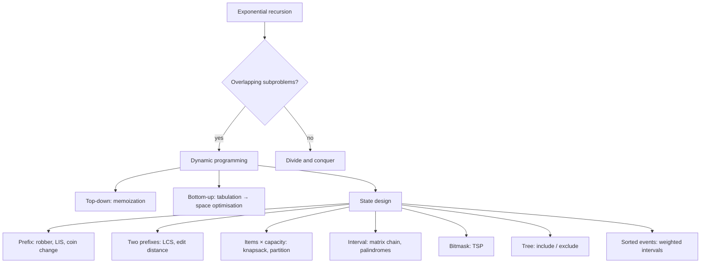

# Module 16 · Dynamic Programming

Prepared by **Hamna Zahid Khan**, Junior Lecturer

[🏠 Course home](../README.md)

> ⏱ 9 contact hours · 3 sessions · 🔴 Advanced

Dynamic programming solves problems whose recursive solutions repeat the same subproblems, by solving each subproblem once and remembering the answer. This module moves from memoised Fibonacci to the classic tables (knapsack, LCS, coin change, LIS, edit distance) and then to advanced state design: intervals, bitmasks, trees and weighted intervals.

## 🎯 Module objectives

- Identify overlapping subproblems and optimal substructure.
- Write memoised (top-down) and tabulated (bottom-up) solutions and optimise their space.
- Apply the recipe: state, recurrence, base cases, order, answer; reconstruct optimal solutions.
- Solve knapsack, LCS, edit distance, coin change and LIS.
- Design interval, bitmask, tree and weighted-interval DPs.

## 📚 Sessions

| # | Session | Key ideas | Code |
|---|---|---|---|
| 1 | [Memoization and Tabulation](session-01-memoization-and-tabulation.md) | overlap, memo vs table, recipe, grid DP, reconstruction | [`DPIntro.java`](src/DPIntro.java) |
| 2 | [Classic DP Problems](session-02-classic-dp-problems.md) | knapsack, LCS, coin change, LIS, edit distance | [`ClassicDP.java`](src/ClassicDP.java) |
| 3 | [Advanced DP Patterns](session-03-advanced-dp.md) | interval, bitmask TSP, tree DP, weighted intervals | [`AdvancedDP.java`](src/AdvancedDP.java) |
| ✍️ | [Practice test](practice-test.md) | 20 MCQs + 3 coding scenarios | [`Labs16.java`](src/Labs16.java), [`SelfCheck.java`](src/SelfCheck.java) |

## 🗺️ Concept map



## 📄 One-page cheat sheet

| Problem | Recurrence | Time |
|---|---|---|
| Fibonacci / stairs | `dp[i] = dp[i−1] + dp[i−2]` | O(n) |
| House robber | `dp[i] = max(dp[i−1], dp[i−2] + a[i])` | O(n) |
| Grid paths | `dp[r][c] = dp[r−1][c] + dp[r][c−1]` | O(RC) |
| 0/1 knapsack | `dp[i][c] = max(dp[i−1][c], dp[i−1][c−w] + v)` | O(nW) |
| LCS | match: `dp[i−1][j−1] + 1`; else `max(up, left)` | O(nm) |
| Edit distance | match: diagonal; else `1 + min(diag, up, left)` | O(nm) |
| Min coins | `dp[a] = min(dp[a−c] + 1)` | O(k·A) |
| Coin ways | coins outer: `dp[a] += dp[a−c]` | O(k·A) |
| LIS | tails + binary search | O(n log n) |
| Matrix chain | `min_k cost[i][k] + cost[k+1][j] + d·d·d` | O(n³) |
| TSP | `dp[mask \| 1<<u][u] = dp[mask][v] + d[v][u]` | O(2ⁿ n²) |

**Recipe:** state (in words) → recurrence → base cases → fill order → answer (→ reconstruction).

## ▶️ Run the code

```bash
cd 16-dynamic-programming/src
javac -d out *.java
java -ea -cp out SelfCheck
java -cp out ClassicDP
java -cp out Labs16 2          # Session 2 lab solutions (1-3)
```

See [`src/README.md`](src/README.md) for every file.
