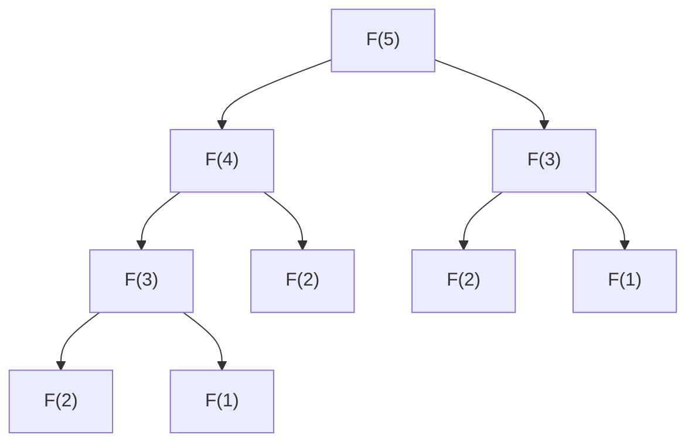

# Session 1 · Memoization and Tabulation

Prepared by **Hamna Zahid Khan**, Junior Lecturer

[🏠 Course home](../README.md) · [📘 Module overview](./README.md) · [⬅ Module overview](./README.md) · [Next ➡](./session-02-classic-dp-problems.md)

> **Module 16 · Dynamic Programming** · ⏱ 3 hours (90 min lecture + 90 min lab)

## 🎯 Learning objectives

1. Recognise the two properties that signal DP: **overlapping subproblems** and **optimal substructure**.
2. Turn an exponential recursion into **top-down memoization**.
3. Write the same solution **bottom-up (tabulation)** and reduce its space.
4. Follow a five-step recipe: state, recurrence, base cases, order, answer.
5. Solve 1-D and 2-D counting/optimisation problems and **reconstruct** the optimal choice.

---

## 1. Why plain recursion explodes

Fibonacci: F(n) = F(n − 1) + F(n − 2). The direct recursion recomputes the same values again and again.



F(3) is computed twice and F(2) three times already for n = 5. For n = 40 the program counts **331 million** calls. Yet there are only **41 different** subproblems: F(0) … F(40).

> 📒 **Analogy: a student's rough notebook during an exam.** When a long calculation needs "the area of the triangle" for the third time, a sensible student copies it from the notebook instead of redoing it. Dynamic programming is exactly that: solve each subproblem once, write it down, and look it up afterwards.

| Property | Meaning | Fibonacci |
|---|---|---|
| **Overlapping subproblems** | the same smaller problems recur many times | F(n − 2) is needed by F(n) and by F(n − 1) |
| **Optimal substructure** | the answer is built from answers to smaller instances | F(n) from F(n − 1), F(n − 2) |

Divide and conquer (merge sort) has optimal substructure but **no** overlap (the halves are disjoint), so caching would not help there. Greedy (Module 15) commits to one choice; DP **tries every choice** but remembers results.

## 2. Two ways to remember

| | Top-down **memoization** | Bottom-up **tabulation** |
|---|---|---|
| Shape | the natural recursion + a cache | loops filling a table |
| Order | computed on demand | you choose the order (smaller first) |
| Computes | only the subproblems actually needed | usually all subproblems |
| Risk | deep recursion (stack overflow) | must find a valid fill order |
| Space trick | rarely | often keep only the last row(s) |

```java
static long fibMemo(int n, long[] memo) {          // top-down
    if (n < 2) return n;
    if (memo[n] != 0) return memo[n];
    return memo[n] = fibMemo(n - 1, memo) + fibMemo(n - 2, memo);
}

static long fibTab(int n) {                         // bottom-up
    long[] dp = new long[n + 1];
    dp[1] = 1;
    for (int i = 2; i <= n; i++) dp[i] = dp[i - 1] + dp[i - 2];
    return dp[n];
}
```

Because `dp[i]` depends only on the two previous entries, two variables suffice: **O(1) space**.

## 3. The five-step recipe

| Step | Question | Climbing stairs (1 or 2 steps) |
|---|---|---|
| 1. **State** | What does `dp[i]` mean, in words? | ways to reach stair i |
| 2. **Recurrence** | How is it built from smaller states? | ways(i) = ways(i − 1) + ways(i − 2) |
| 3. **Base cases** | Which states are known directly? | ways(0) = 1, ways(1) = 1 |
| 4. **Order** | In which order can the table be filled? | i = 2, 3, …, n |
| 5. **Answer** | Which entry (or combination) is returned? | ways(n) |

Writing step 1 as an English sentence is the most important habit in DP. A vague state leads to a wrong recurrence.

## 4. 2-D DP on a grid

**Unique paths with walls.** Move only right or down from the top-left to the bottom-right; '#' cells are blocked.

State: `dp[r][c]` = number of paths reaching (r, c). Recurrence: `dp[r][c] = dp[r − 1][c] + dp[r][c − 1]` (0 for walls). Order: row by row, left to right.

| Grid | dp table |
|---|---|
| `. . . .` | 1 1 1 1 |
| `. # . .` | 1 0 1 2 |
| `. . . #` | 1 1 2 0 |
| `# . . .` | 0 1 3 **3** |

**Minimum-cost path.** Each cell has a cost; minimise the total. `dp[r][c] = cost[r][c] + min(dp[r − 1][c], dp[r][c − 1])`.

**Reconstruction.** To recover the actual path, start at the end and step back to whichever neighbour produced the minimum, then reverse the moves. The program prints `RRDDDR` with total cost 11.

## 5. Complexity table

| Problem | States | Work per state | Time | Space (optimised) |
|---|---|---|---|---|
| Fibonacci, naive | – | – | O(φⁿ) ≈ O(1.618ⁿ) | O(n) stack |
| Fibonacci, DP | n | O(1) | O(n) | O(1) |
| Climbing stairs | n | O(1) | O(n) | O(1) |
| Grid paths R × C | R·C | O(1) | O(R·C) | O(C) one row |
| Min-cost path | R·C | O(1) | O(R·C) | O(C) (O(R·C) to reconstruct) |

General rule: **time = number of states × work per state.**

---

## 6. Complete program

📄 **[`src/DPIntro.java`](src/DPIntro.java)**

```java
import java.util.Arrays;

/**
 * Session 1 demo: from exponential recursion to dynamic programming. Fibonacci four ways (naive,
 * memoised, tabulated, O(1) space) with call counts and timings, climbing stairs, grid paths with
 * obstacles, and minimum-cost path with path reconstruction.
 *
 * Compile:  javac -d out DPIntro.java
 * Run:      java -cp out DPIntro
 *
 * Prepared by Hamna Zahid Khan, Junior Lecturer
 */
public class DPIntro {
    static long calls;

    static long fibNaive(int n) { calls++; return n < 2 ? n : fibNaive(n - 1) + fibNaive(n - 2); }

    /** Top-down: same recursion, but each answer is stored the first time it is computed. */
    static long fibMemo(int n, long[] memo) {
        calls++;
        if (n < 2) return n;
        if (memo[n] != 0) return memo[n];
        return memo[n] = fibMemo(n - 1, memo) + fibMemo(n - 2, memo);
    }

    /** Bottom-up: fill the table from the base cases upwards. */
    static long fibTab(int n) {
        if (n < 2) return n;
        long[] dp = new long[n + 1];
        dp[1] = 1;
        for (int i = 2; i <= n; i++) dp[i] = dp[i - 1] + dp[i - 2];
        return dp[n];
    }

    /** Only the last two values are ever needed: O(1) space. */
    static long fibTwoVars(int n) {
        long a = 0, b = 1;
        for (int i = 0; i < n; i++) { long t = a + b; a = b; b = t; }
        return a;
    }

    /** Ways to climb n stairs taking 1 or 2 steps: ways(i) = ways(i-1) + ways(i-2). */
    static long[] stairs(int n) {
        long[] w = new long[n + 1];
        w[0] = 1;
        for (int i = 1; i <= n; i++) w[i] = w[i - 1] + (i >= 2 ? w[i - 2] : 0);
        return w;
    }

    /** Paths from top-left to bottom-right moving right/down, avoiding blocked cells ('#'). */
    static long[][] gridPaths(String[] g) {
        int R = g.length, C = g[0].length();
        long[][] dp = new long[R][C];
        for (int r = 0; r < R; r++)
            for (int c = 0; c < C; c++) {
                if (g[r].charAt(c) == '#') continue;               // 0 ways through a wall
                if (r == 0 && c == 0) { dp[r][c] = 1; continue; }
                dp[r][c] = (r > 0 ? dp[r - 1][c] : 0) + (c > 0 ? dp[r][c - 1] : 0);
            }
        return dp;
    }

    /** Minimum-cost path (right/down) and the path itself, rebuilt by walking back through choices. */
    static String minCostPath(int[][] cost) {
        int R = cost.length, C = cost[0].length;
        int[][] dp = new int[R][C];
        for (int r = 0; r < R; r++)
            for (int c = 0; c < C; c++) {
                if (r == 0 && c == 0) dp[r][c] = cost[0][0];
                else if (r == 0) dp[r][c] = dp[r][c - 1] + cost[r][c];
                else if (c == 0) dp[r][c] = dp[r - 1][c] + cost[r][c];
                else dp[r][c] = Math.min(dp[r - 1][c], dp[r][c - 1]) + cost[r][c];
            }
        StringBuilder path = new StringBuilder();
        int r = R - 1, c = C - 1;
        while (r > 0 || c > 0) {                                     // reconstruct backwards
            if (r == 0) { path.append('R'); c--; }
            else if (c == 0) { path.append('D'); r--; }
            else if (dp[r - 1][c] <= dp[r][c - 1]) { path.append('D'); r--; }
            else { path.append('R'); c--; }
        }
        StringBuilder table = new StringBuilder();
        for (int[] row : dp) table.append("  ").append(Arrays.toString(row)).append('\n');
        return table + "  min cost = " + dp[R - 1][C - 1] + ", moves = " + path.reverse();
    }

    public static void main(String[] args) {
        System.out.println("== Fibonacci four ways ==");
        System.out.println("  n   naive calls   memo calls   value");
        for (int n : new int[]{10, 20, 30, 40}) {
            calls = 0;
            long v = fibNaive(n);
            long naive = calls;
            calls = 0;
            fibMemo(n, new long[n + 1]);
            System.out.printf("%3d   %11d   %10d   %d%n", n, naive, calls, v);
        }
        System.out.println("fibTab(90) = " + fibTab(90) + ", fibTwoVars(90) = " + fibTwoVars(90));

        long t0 = System.nanoTime();
        fibNaive(40);
        long naiveMs = (System.nanoTime() - t0) / 1_000_000;
        t0 = System.nanoTime();
        fibTab(40);
        long tabUs = (System.nanoTime() - t0) / 1_000;
        System.out.println("time for n = 40: naive ≈ " + (naiveMs > 100 ? "hundreds of ms" : "tens of ms")
                + ", table ≈ " + (tabUs < 1000 ? "under a millisecond" : "a few ms"));

        System.out.println("\n== Climbing stairs (1 or 2 steps) ==");
        System.out.println("ways for n = 0..10: " + Arrays.toString(stairs(10)));

        System.out.println("\n== Grid paths around blocked cells ==");
        String[] grid = {"....", ".#..", "...#", "#..."};
        for (String row : grid) System.out.println("  " + row);
        long[][] dp = gridPaths(grid);
        for (long[] row : dp) System.out.println("  " + Arrays.toString(row));
        System.out.println("  paths = " + dp[3][3]);

        System.out.println("\n== Minimum-cost path (right/down) ==");
        int[][] cost = {{1, 3, 1, 8}, {1, 5, 1, 2}, {4, 2, 1, 9}, {7, 1, 3, 1}};
        System.out.println(minCostPath(cost));
    }
}
```

**Real output:**

```text
$ java -cp out DPIntro
== Fibonacci four ways ==
  n   naive calls   memo calls   value
 10           177           19   55
 20         21891           39   6765
 30       2692537           59   832040
 40     331160281           79   102334155
fibTab(90) = 2880067194370816120, fibTwoVars(90) = 2880067194370816120
time for n = 40: naive ≈ hundreds of ms, table ≈ under a millisecond

== Climbing stairs (1 or 2 steps) ==
ways for n = 0..10: [1, 1, 2, 3, 5, 8, 13, 21, 34, 55, 89]

== Grid paths around blocked cells ==
  ....
  .#..
  ...#
  #...
  [1, 1, 1, 1]
  [1, 0, 1, 2]
  [1, 1, 2, 0]
  [0, 1, 3, 3]
  paths = 3

== Minimum-cost path (right/down) ==
  [1, 4, 5, 13]
  [2, 7, 6, 8]
  [6, 8, 7, 16]
  [13, 9, 10, 11]
  min cost = 11, moves = RRDDDR
```

---

## 7. Worked examples (basic → advanced)

**Example 1 (basic): house robber.** Houses in a row hold money; robbing two neighbours triggers an alarm. State: best(i) = most money from the first i houses. Either skip house i (best(i − 1)) or rob it (best(i − 2) + a[i]).

```java
/** Max money from houses in a row without robbing two neighbours: best(i) = max(best(i-1), best(i-2) + a[i]). */
static int houseRobber(int[] a) {
    int prev2 = 0, prev1 = 0;                       // best up to i-2 and i-1
    for (int x : a) { int cur = Math.max(prev1, prev2 + x); prev2 = prev1; prev1 = cur; }
    return prev1;
}
```
<sub>Full, compiled version: [`src/Labs16.java`](src/Labs16.java)</sub>

| house | 2 | 7 | 9 | 3 | 1 |
|---|---|---|---|---|---|
| best | 2 | 7 | 11 | 11 | **12** |

**Example 2 (intermediate): decode ways.** "A" = 1 … "Z" = 26. How many ways can "226" be decoded? A position can be reached by a single digit 1-9 or by a two-digit number 10-26.

```java
/** Ways to decode a digit string where 'A'=1 ... 'Z'=26. ways(i) uses one digit or two digits. */
static int decodeWays(String s) {
    int n = s.length();
    int[] dp = new int[n + 1];
    dp[0] = 1;
    for (int i = 1; i <= n; i++) {
        if (s.charAt(i - 1) != '0') dp[i] += dp[i - 1];                         // single digit 1-9
        if (i >= 2) {
            int two = Integer.parseInt(s.substring(i - 2, i));
            if (two >= 10 && two <= 26) dp[i] += dp[i - 2];                       // two digits 10-26
        }
    }
    return dp[n];
}
```
<sub>Full, compiled version: [`src/Labs16.java`](src/Labs16.java)</sub>

| i | prefix | single digit | two digits | ways |
|---|---|---|---|---|
| 0 | "" | – | – | 1 |
| 1 | "2" | +ways(0) | – | 1 |
| 2 | "22" | +ways(1) | 22 ✓ +ways(0) | 2 |
| 3 | "226" | +ways(2) | 26 ✓ +ways(1) | **3** (BZ, VF, BBF) |

**Example 3 (advanced): memo vs table on a grid.** Write the grid-paths recurrence top-down with `Long[][] memo` and compare: both are O(R·C), but the recursive version reaches depth R + C and visits only cells that can reach the target, while the table fills every cell. For a 2000 × 2000 grid the recursion depth (4000) is fine; for 10⁶ × 1 it would overflow the stack, so tabulation is safer.

## 8. Real-life problem: counting delivery routes in a gated housing scheme

**Problem.** A courier inside a housing scheme laid out as a 12 × 15 block grid can only travel east or south (one-way streets). Some blocks are closed for construction. Dispatch wants to know how many distinct routes exist from the gate to a customer, to estimate congestion if they split riders across routes.

**Solution.** This is grid paths with walls: 180 states, O(1) each. A brute-force enumeration of routes could face up to C(25, 11) ≈ 4.5 million paths (11 moves south and 14 east in any order); the DP table answers instantly and, with a `long` table, handles much larger grids. Changing a closed block only requires recomputing the table, still instant.

## 9. Common mistakes

| Mistake | Fix |
|---|---|
| No clear meaning for `dp[i]` | write the state as a sentence before coding |
| Using 0 as "not computed" when 0 is a valid answer | use `Long[]` with `null`, or fill with −1 |
| Filling the table in an order that reads uncomputed cells | make sure every dependency is filled first |
| Off-by-one between "first i items" and "index i" | size tables n + 1 and keep one convention |
| Overflow in counting problems | `long`, or modulo 10⁹ + 7 when asked |
| Forgetting walls / invalid states | set them to 0 (counting) or ∞ (minimising) |

## 10. Best practices

- Start with the recursive brute force; add a memo; then convert to a table if needed.
- Draw the table for a tiny input and fill it by hand before coding.
- Optimise space only after the full-table version works.
- Keep a separate `choice[][]` (or recompute) when the solution itself, not just its value, is required.

---

## 11. Lab tasks

**Lab 1.1: House robber.**

<details>
<summary>✅ Solution</summary>

See Example 1.

</details>

**Lab 1.2: Decode ways.** Test "226", "1201" and "06".

<details>
<summary>✅ Solution</summary>

See Example 2. "1201" has only **1** decoding (1-20-1) because "0" cannot stand alone; "06" has **0**.

</details>

**Lab 1.3: Stairs with 1, 2 or 3 steps.** Change the recurrence and print ways(0..10).

<details>
<summary>✅ Solution</summary>

`w[i] = w[i − 1] + w[i − 2] + w[i − 3]` with w[0] = 1 (treat negative indices as 0): 1, 1, 2, 4, 7, 13, 24, 44, 81, 149, **274** (the "tribonacci" numbers).

</details>

**Lab 1.4: Space-optimised grid paths.** Rewrite `gridPaths` with a single 1-D array of length C.

<details>
<summary>✅ Solution</summary>

```java
long[] row = new long[C];
for (int r = 0; r < R; r++)
    for (int c = 0; c < C; c++) {
        if (g[r].charAt(c) == '#') row[c] = 0;
        else if (r == 0 && c == 0) row[c] = 1;
        else if (c > 0) row[c] += row[c - 1];     // row[c] still holds the value from the row above
    }
return row[C - 1];
```

`row[c]` before the update is "from above"; `row[c − 1]` after its update is "from the left". O(C) space.

</details>

**Real output of the Session 1 lab solutions:**

```text
$ java -cp out Labs16 1
-- Session 1 labs --
houseRobber([2, 7, 9, 3, 1]) = 12
decodeWays("226") = 3, decodeWays("1201") = 1, decodeWays("06") = 0
```

---

## 12. Quiz

**Q1.** Dynamic programming is useful when a problem has:

- **A.** no subproblems
- **B.** overlapping subproblems and optimal substructure
- **C.** only greedy choices
- **D.** random input

**Q2.** Memoization stores results:

- **A.** before any recursion
- **B.** the first time each subproblem is computed, then reuses them
- **C.** only for the final answer
- **D.** in a stack

**Q3.** The naive recursive Fibonacci runs in:

- **A.** O(n)
- **B.** O(n log n)
- **C.** O(n²)
- **D.** exponential time

**Q4.** In grid paths (right/down moves), dp[r][c] depends on:

- **A.** dp[r+1][c] and dp[r][c+1]
- **B.** dp[r−1][c] and dp[r][c−1]
- **C.** all cells in the row
- **D.** dp[0][0] only

**Q5.** The time of a DP solution is usually:

- **A.** number of states × work per state
- **B.** always O(n)
- **C.** the depth of recursion
- **D.** number of base cases

<details>
<summary><b>Show answers</b></summary>

1. **B**: Reuse answers to repeated subproblems.
2. **B**: Top-down caching.
3. **D**: About 1.618ⁿ calls.
4. **B**: You arrive from above or from the left.
5. **A**: Each state is solved once.

</details>

---

## 13. Summary

- DP = recursion + remembering: **overlapping subproblems** + **optimal substructure**.
- **Memoization** (top-down) and **tabulation** (bottom-up) compute the same values; tabulation enables space optimisation.
- Recipe: state → recurrence → base cases → order → answer.
- Reconstruct solutions by walking back through the choices that produced the optimum.

## 14. Viva / interview questions

1. Explain the difference between divide and conquer and dynamic programming.
2. When would memoization be faster than tabulation?
3. Derive the number of calls made by naive Fibonacci.
4. How do you choose the fill order of a 2-D table?
5. How would you count paths modulo 10⁹ + 7, and why are such moduli used?
6. Convert the house-robber problem to a circle of houses (first and last are neighbours).

---

[⬅ Module overview](./README.md) · [📘 Module overview](./README.md) · [Next ➡](./session-02-classic-dp-problems.md)
