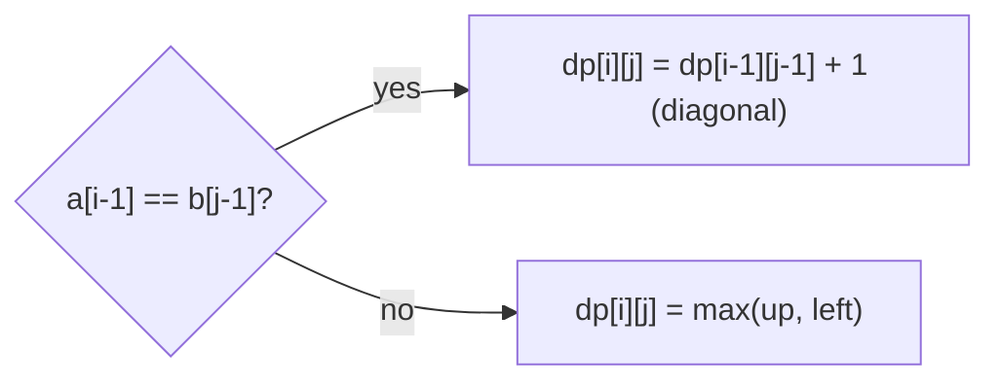

# Session 2 · Classic DP Problems

Prepared by **Hamna Zahid Khan**, Junior Lecturer

[🏠 Course home](../README.md) · [📘 Module overview](./README.md) · [⬅ Previous](./session-01-memoization-and-tabulation.md) · [Next ➡](./session-03-advanced-dp.md)

> **Module 16 · Dynamic Programming** · ⏱ 3 hours (90 min lecture + 90 min lab)

## 🎯 Learning objectives

1. Solve the **0/1 knapsack** with a 2-D table, recover the chosen items, and reduce it to one row.
2. Compute the **longest common subsequence (LCS)** and reconstruct it.
3. Solve **coin change** for minimum coins and for the number of ways, and explain why loop order matters.
4. Find the **longest increasing subsequence (LIS)** in O(n²) and O(n log n).
5. Compute **edit distance** and relate it to real tools (spell checkers, diff).

---

## 1. 0/1 knapsack

Items have weights and values; a bag holds capacity W; each item is taken **whole or not at all**. Greedy fails (Module 15), but DP is exact.

> 🎒 **Analogy: packing a 7 kg cabin bag.** For each item you face one question: "take it or leave it?". The best packing of the first i items into c kilograms either ignores item i (best of the first i − 1 items in c kg) or takes it (its value plus the best of the first i − 1 items in c − wᵢ kg).

| Step | Knapsack |
|---|---|
| State | `dp[i][c]` = best value using the first i items with capacity c |
| Recurrence | `dp[i][c] = max(dp[i−1][c], dp[i−1][c − wᵢ] + vᵢ)` (second only if wᵢ ≤ c) |
| Base | `dp[0][c] = 0` |
| Order | i from 1 to n, any c order |
| Answer | `dp[n][W]` |

### Dry run: laptop 3 kg/40, charger 1 kg/10, books 4 kg/35, camera 2 kg/25, W = 7

| i (item) | c = 0 | 1 | 2 | 3 | 4 | 5 | 6 | 7 |
|---|---|---|---|---|---|---|---|---|
| 0 | 0 | 0 | 0 | 0 | 0 | 0 | 0 | 0 |
| 1 laptop | 0 | 0 | 0 | 40 | 40 | 40 | 40 | 40 |
| 2 charger | 0 | 10 | 10 | 40 | 50 | 50 | 50 | 50 |
| 3 books | 0 | 10 | 10 | 40 | 50 | 50 | 50 | **75** |
| 4 camera | 0 | 10 | 25 | 40 | 50 | 65 | 75 | **75** |

**Reconstruction:** walk up from `dp[4][7]`; if the value differs from the row above, the item was taken. Here 75 = laptop + books (camera + laptop + charger also gives 75: ties are normal).

**Space optimisation:** keep one row and loop c **downwards** so `dp[c − wᵢ]` still holds the previous row's value (looping upwards would let an item be used twice, which is the *unbounded* knapsack).

## 2. Longest common subsequence

A **subsequence** keeps order but may skip characters ("ACE" is a subsequence of "ABCDE"). LCS powers `diff`, DNA alignment and plagiarism checks.

| Step | LCS of a (length n) and b (length m) |
|---|---|
| State | `dp[i][j]` = LCS length of a[0..i) and b[0..j) |
| Recurrence | equal last chars: `dp[i−1][j−1] + 1`; else `max(dp[i−1][j], dp[i][j−1])` |
| Base | row 0 and column 0 are 0 |
| Answer | `dp[n][m]`; walk back to rebuild the string |



For "ABCBDAB" and "BDCABA" the table (printed by the program) ends in **4**, and walking back gives **BCBA**.

## 3. Coin change, two versions

| Version | State | Recurrence | Loop order |
|---|---|---|---|
| Fewest coins | `dp[a]` = min coins for amount a | `min over coins c ≤ a of dp[a − c] + 1` | amounts outer (either works) |
| Number of ways | `dp[a]` = ways to make a | `dp[a] += dp[a − c]` | **coins outer**, amounts inner |

Why does the loop order matter for counting? With coins outside, each combination is built in one fixed coin order, so {1, 2} and {2, 1} count once. With amounts outside you count **ordered** sequences (permutations), a different question.

| Query | Answer |
|---|---|
| min coins for 6 with {1, 3, 4} | **2** (3 + 3), where greedy gave 3 |
| ways to make 10 with {1, 2, 5} | **10** |
| ways to make Rs 100 with PKR coins and notes | **4563** |

## 4. Longest increasing subsequence

**O(n²):** `dp[i]` = length of the LIS **ending at i** = 1 + max dp[j] over j < i with a[j] < a[i]. Keep `prev[i]` to rebuild the sequence.

**O(n log n):** keep `tails[k]` = the smallest possible last value of an increasing subsequence of length k + 1. For each x, binary-search the first tail ≥ x and replace it (or append). `tails` stays sorted, and its length is the LIS length.

| x | tails after |
|---|---|
| 52 | [52] |
| 48 | [48] |
| 60 | [48, 60] |
| 55 | [48, 55] |
| 70 | [48, 55, 70] |
| 65 | [48, 55, 65] |
| 80 | [48, 55, 65, 80] |
| 58 | [48, 55, 58, 80] |
| 90 | [48, 55, 58, 80, 90] ⇒ length **5** |

(`tails` is not itself an LIS; only its length is meaningful.)

## 5. Complexity table

| Problem | States | Time | Space (optimised) |
|---|---|---|---|
| 0/1 knapsack | n × W | O(nW) (pseudo-polynomial) | O(W) |
| LCS | n × m | O(nm) | O(min(n, m)) for the length |
| Edit distance | n × m | O(nm) | O(min(n, m)) |
| Coin change (k coins) | amount | O(k · amount) | O(amount) |
| LIS | n | O(n²) or **O(n log n)** | O(n) |

*Pseudo-polynomial:* O(nW) depends on the **value** of W, not its number of digits; with W = 10⁹ the table is too big.

---

## 6. Complete program

📄 **[`src/ClassicDP.java`](src/ClassicDP.java)**

```java
import java.util.ArrayList;
import java.util.Arrays;
import java.util.Collections;
import java.util.List;

/**
 * Session 2 demo: classic dynamic-programming problems with tables and reconstruction:
 * 0/1 knapsack (2-D table, chosen items, 1-D space optimisation), longest common subsequence,
 * coin change (minimum coins and number of ways), and longest increasing subsequence (O(n^2) and O(n log n)).
 *
 * Compile:  javac -d out ClassicDP.java
 * Run:      java -cp out ClassicDP
 *
 * Prepared by Hamna Zahid Khan, Junior Lecturer
 */
public class ClassicDP {

    /** dp[i][c] = best value using the first i items with capacity c. */
    static int[][] knapsackTable(int[] w, int[] v, int cap) {
        int n = w.length;
        int[][] dp = new int[n + 1][cap + 1];
        for (int i = 1; i <= n; i++)
            for (int c = 0; c <= cap; c++) {
                dp[i][c] = dp[i - 1][c];                                    // skip item i
                if (w[i - 1] <= c) dp[i][c] = Math.max(dp[i][c], dp[i - 1][c - w[i - 1]] + v[i - 1]);   // take it
            }
        return dp;
    }

    static List<Integer> knapsackItems(int[][] dp, int[] w) {
        List<Integer> items = new ArrayList<>();
        int c = dp[0].length - 1;
        for (int i = dp.length - 1; i > 0; i--)
            if (dp[i][c] != dp[i - 1][c]) { items.add(i - 1); c -= w[i - 1]; }   // value changed => item taken
        Collections.reverse(items);
        return items;
    }

    /** Same answer with one row; iterate capacity DOWNWARDS so each item is used at most once. */
    static int knapsack1D(int[] w, int[] v, int cap) {
        int[] dp = new int[cap + 1];
        for (int i = 0; i < w.length; i++)
            for (int c = cap; c >= w[i]; c--) dp[c] = Math.max(dp[c], dp[c - w[i]] + v[i]);
        return dp[cap];
    }

    /** LCS length table and one longest common subsequence. */
    static String lcs(String a, String b, int[][] outTable) {
        int n = a.length(), m = b.length();
        int[][] dp = outTable != null ? outTable : new int[n + 1][m + 1];
        for (int i = 1; i <= n; i++)
            for (int j = 1; j <= m; j++)
                dp[i][j] = a.charAt(i - 1) == b.charAt(j - 1) ? dp[i - 1][j - 1] + 1 : Math.max(dp[i - 1][j], dp[i][j - 1]);
        StringBuilder sb = new StringBuilder();
        for (int i = n, j = m; i > 0 && j > 0; ) {
            if (a.charAt(i - 1) == b.charAt(j - 1)) { sb.append(a.charAt(i - 1)); i--; j--; }
            else if (dp[i - 1][j] >= dp[i][j - 1]) i--;
            else j--;
        }
        return sb.reverse().toString();
    }

    /** Fewest coins to make amount (-1 if impossible). Works for ANY coin system. */
    static int minCoins(int[] coins, int amount) {
        int[] dp = new int[amount + 1];
        Arrays.fill(dp, Integer.MAX_VALUE);
        dp[0] = 0;
        for (int a = 1; a <= amount; a++)
            for (int c : coins)
                if (c <= a && dp[a - c] != Integer.MAX_VALUE) dp[a] = Math.min(dp[a], dp[a - c] + 1);
        return dp[amount] == Integer.MAX_VALUE ? -1 : dp[amount];
    }

    /** Number of ways (combinations, order ignored): loop coins OUTSIDE, amounts inside. */
    static long coinWays(int[] coins, int amount) {
        long[] dp = new long[amount + 1];
        dp[0] = 1;
        for (int c : coins)
            for (int a = c; a <= amount; a++) dp[a] += dp[a - c];
        return dp[amount];
    }

    /** LIS in O(n^2): dp[i] = length of the longest increasing subsequence ending at i. */
    static List<Integer> lisQuadratic(int[] a) {
        int n = a.length;
        int[] dp = new int[n], prev = new int[n];
        int best = 0;
        for (int i = 0; i < n; i++) {
            dp[i] = 1;
            prev[i] = -1;
            for (int j = 0; j < i; j++)
                if (a[j] < a[i] && dp[j] + 1 > dp[i]) { dp[i] = dp[j] + 1; prev[i] = j; }
            if (dp[i] > dp[best]) best = i;
        }
        List<Integer> seq = new ArrayList<>();
        for (int i = best; i != -1; i = prev[i]) seq.add(a[i]);
        Collections.reverse(seq);
        return seq;
    }

    /** LIS length in O(n log n): tails[k] = smallest possible tail of an increasing subsequence of length k+1. */
    static int lisFast(int[] a) {
        int[] tails = new int[a.length];
        int len = 0;
        for (int x : a) {
            int i = Arrays.binarySearch(tails, 0, len, x);
            if (i < 0) i = -(i + 1);              // insertion point
            tails[i] = x;
            if (i == len) len++;
        }
        return len;
    }

    public static void main(String[] args) {
        System.out.println("== 0/1 knapsack: laptop bag, capacity 7 kg ==");
        String[] names = {"laptop", "charger", "books", "camera"};
        int[] w = {3, 1, 4, 2}, v = {40, 10, 35, 25};
        int[][] dp = knapsackTable(w, v, 7);
        System.out.println("    c = 0..7");
        for (int i = 0; i < dp.length; i++)
            System.out.printf("  i=%d %-8s %s%n", i, i == 0 ? "(none)" : names[i - 1], Arrays.toString(dp[i]));
        List<String> chosen = new ArrayList<>();
        for (int i : knapsackItems(dp, w)) chosen.add(names[i]);
        System.out.println("best value = " + dp[4][7] + " with " + chosen + "; 1-D version = " + knapsack1D(w, v, 7));

        System.out.println("\n== Longest common subsequence ==");
        String a = "ABCBDAB", b = "BDCABA";
        int[][] t = new int[a.length() + 1][b.length() + 1];
        String s = lcs(a, b, t);
        System.out.println("      " + String.join("  ", b.split("")));
        for (int i = 1; i <= a.length(); i++) {
            StringBuilder row = new StringBuilder("  " + a.charAt(i - 1) + " ");
            for (int j = 1; j <= b.length(); j++) row.append(String.format("%3d", t[i][j]));
            System.out.println(row);
        }
        System.out.println("LCS(" + a + ", " + b + ") = " + s + " (length " + s.length() + ")");
        System.out.println("LCS of two student answers: \"" + lcs("the stack is lifo", "a stack is last in first out", null) + "\"");

        System.out.println("\n== Coin change ==");
        System.out.println("minCoins({1, 3, 4}, 6) = " + minCoins(new int[]{1, 3, 4}, 6) + "  (greedy gave 3)");
        System.out.println("minCoins({2}, 3) = " + minCoins(new int[]{2}, 3));
        System.out.println("ways to make 10 from {1, 2, 5} = " + coinWays(new int[]{1, 2, 5}, 10));
        System.out.println("ways to make Rs 100 from {1, 2, 5, 10, 20, 50, 100} = " + coinWays(new int[]{1, 2, 5, 10, 20, 50, 100}, 100));

        System.out.println("\n== Longest increasing subsequence ==");
        int[] marks = {52, 48, 60, 55, 70, 65, 80, 58, 90};
        System.out.println("marks = " + Arrays.toString(marks));
        System.out.println("O(n^2) LIS = " + lisQuadratic(marks) + ", O(n log n) length = " + lisFast(marks));
    }
}
```

**Real output:**

```text
$ java -cp out ClassicDP
== 0/1 knapsack: laptop bag, capacity 7 kg ==
    c = 0..7
  i=0 (none)   [0, 0, 0, 0, 0, 0, 0, 0]
  i=1 laptop   [0, 0, 0, 40, 40, 40, 40, 40]
  i=2 charger  [0, 10, 10, 40, 50, 50, 50, 50]
  i=3 books    [0, 10, 10, 40, 50, 50, 50, 75]
  i=4 camera   [0, 10, 25, 40, 50, 65, 75, 75]
best value = 75 with [laptop, books]; 1-D version = 75

== Longest common subsequence ==
      B  D  C  A  B  A
  A   0  0  0  1  1  1
  B   1  1  1  1  2  2
  C   1  1  2  2  2  2
  B   1  1  2  2  3  3
  D   1  2  2  2  3  3
  A   1  2  2  3  3  4
  B   1  2  2  3  4  4
LCS(ABCBDAB, BDCABA) = BCBA (length 4)
LCS of two student answers: " stack is lifo"

== Coin change ==
minCoins({1, 3, 4}, 6) = 2  (greedy gave 3)
minCoins({2}, 3) = -1
ways to make 10 from {1, 2, 5} = 10
ways to make Rs 100 from {1, 2, 5, 10, 20, 50, 100} = 4563

== Longest increasing subsequence ==
marks = [52, 48, 60, 55, 70, 65, 80, 58, 90]
O(n^2) LIS = [52, 60, 70, 80, 90], O(n log n) length = 5
```

---

## 7. Worked examples (basic → advanced)

**Example 1 (basic): partition into equal sums.** Can [1, 5, 11, 5] be split into two groups with equal totals? That is "is there a subset with sum total/2 = 11?", a boolean knapsack. Loop sums downwards so each number is used once.

```java
/** Can the array be split into two groups with equal sums? Subset sum to total/2 with a boolean table. */
static boolean canPartition(int[] a) {
    int total = Arrays.stream(a).sum();
    if (total % 2 == 1) return false;
    boolean[] can = new boolean[total / 2 + 1];
    can[0] = true;
    for (int x : a)
        for (int s = total / 2; s >= x; s--) can[s] |= can[s - x];        // downwards: each item once
    return can[total / 2];
}
```
<sub>Full, compiled version: [`src/Labs16.java`](src/Labs16.java)</sub>

[1, 5, 11, 5] → true ({11} and {1, 5, 5}); [1, 2, 3, 5] → false (odd total 11).

**Example 2 (intermediate): edit distance.** The minimum number of insertions, deletions and substitutions to turn "kitten" into "sitting".

```java
/** Minimum insertions, deletions and substitutions to turn a into b. */
static int editDistance(String a, String b) {
    int n = a.length(), m = b.length();
    int[][] dp = new int[n + 1][m + 1];
    for (int i = 0; i <= n; i++) dp[i][0] = i;            // delete everything
    for (int j = 0; j <= m; j++) dp[0][j] = j;            // insert everything
    for (int i = 1; i <= n; i++)
        for (int j = 1; j <= m; j++)
            dp[i][j] = a.charAt(i - 1) == b.charAt(j - 1) ? dp[i - 1][j - 1]
                    : 1 + Math.min(dp[i - 1][j - 1], Math.min(dp[i - 1][j], dp[i][j - 1]));
    return dp[n][m];
}
```
<sub>Full, compiled version: [`src/Labs16.java`](src/Labs16.java)</sub>

| | "" | s | i | t | t | i | n | g |
|---|---|---|---|---|---|---|---|---|
| "" | 0 | 1 | 2 | 3 | 4 | 5 | 6 | 7 |
| k | 1 | 1 | 2 | 3 | 4 | 5 | 6 | 7 |
| i | 2 | 2 | 1 | 2 | 3 | 4 | 5 | 6 |
| t | 3 | 3 | 2 | 1 | 2 | 3 | 4 | 5 |
| t | 4 | 4 | 3 | 2 | 1 | 2 | 3 | 4 |
| e | 5 | 5 | 4 | 3 | 2 | 2 | 3 | 4 |
| n | 6 | 6 | 5 | 4 | 3 | 3 | 2 | 3 |

Answer **3**: k→s, e→i, insert g.

**Example 3 (advanced): LIS with reconstruction.** For marks [52, 48, 60, 55, 70, 65, 80, 58, 90], the O(n²) version with `prev[]` returns [52, 60, 70, 80, 90]: the longest run of improving test scores, in order, possibly with gaps.

## 8. Real-life problem: "did you mean …?" in the student portal search

**Problem.** Students often mistype course names ("Data Strucutres", "Algoritms"). The portal should suggest the closest course title from about 400 titles.

**Solution.** Compute the edit distance between the query and each title (O(L²) each, L ≈ 30), and suggest the title with the smallest distance if it is at most 2-3. 400 × 900 ≈ 360,000 cell updates per query: instantaneous. For large dictionaries, spell checkers first narrow candidates with a trie or n-gram index (Module 13), then rank them with edit distance.

## 9. Common mistakes

| Mistake | Fix |
|---|---|
| 1-D knapsack with capacity loop going **up** | go **down** for 0/1; up means unlimited copies |
| Coin "ways" with amount loop outside | coins outside (combinations) unless order matters |
| Using `Integer.MAX_VALUE` then adding 1 | check for "impossible" before adding |
| LCS vs longest common **substring** | substring needs contiguous matches: reset to 0 on mismatch |
| Treating `tails` as the actual LIS | use `prev[]` (O(n²)) or store indices with parents |
| Huge W in knapsack | table too large; consider DP over values or other methods |

## 10. Best practices

- Keep the full 2-D table while developing; it makes reconstruction and debugging easy.
- Print small tables (as the program does) and check them against hand calculations.
- Name the dimensions: "first i items", "capacity c", "prefix lengths i and j".
- Recognise families: subset-sum/partition/knapsack; LCS/edit distance/alignment; LIS/box stacking/envelopes.

---

## 11. Lab tasks

**Lab 2.1: Equal partition.**

<details>
<summary>✅ Solution</summary>

See Example 1.

</details>

**Lab 2.2: Edit distance.** Also compute "algorithm" → "altruistic".

<details>
<summary>✅ Solution</summary>

See Example 2. The program prints **6** for algorithm → altruistic.

</details>

**Lab 2.3: Knapsack items.** Reconstruct the items for capacity 5 in the laptop-bag table. Is the answer unique?

<details>
<summary>✅ Solution</summary>

`dp[4][5]` = 65 ≠ `dp[3][5]` = 50 ⇒ camera taken, capacity 3 left; `dp[3][3]` = 40 = `dp[2][3]` ⇒ books not taken; `dp[2][3]` = 40 = `dp[1][3]` ⇒ charger not taken; `dp[1][3]` = 40 ≠ 0 ⇒ laptop taken. **Laptop + camera = 65**, the unique optimum for 5 kg.

</details>

**Lab 2.4: Longest common substring.** Modify LCS so matches must be contiguous. What is the longest common substring of "ABCBDAB" and "BDCABA"?

<details>
<summary>✅ Solution</summary>

`dp[i][j] = a[i−1] == b[j−1] ? dp[i−1][j−1] + 1 : 0`, and track the maximum cell. The longest have length **2**: "AB" and "BD"; no length-3 substring is shared.

</details>

**Real output of the Session 2 lab solutions:**

```text
$ java -cp out Labs16 2
-- Session 2 labs --
editDistance(kitten, sitting) = 3, editDistance(algorithm, altruistic) = 6
canPartition([1, 5, 11, 5]) = true, canPartition([1, 2, 3, 5]) = false
```

---

## 12. Quiz

**Q1.** In 0/1 knapsack, dp[i][c] = max(dp[i−1][c], dp[i−1][c−wᵢ] + vᵢ). The first term means:

- **A.** take item i
- **B.** skip item i
- **C.** take item i twice
- **D.** empty bag

**Q2.** In the 1-D 0/1 knapsack, the capacity loop must run:

- **A.** upwards
- **B.** downwards
- **C.** in random order
- **D.** twice

**Q3.** LCS("ABC", "AC") is:

- **A.** "A"
- **B.** "AC"
- **C.** "ABC"
- **D.** "C"

**Q4.** Counting coin combinations (order ignored) requires:

- **A.** amounts in the outer loop
- **B.** coins in the outer loop
- **C.** sorting coins descending
- **D.** recursion only

**Q5.** The O(n log n) LIS algorithm keeps tails[k] as:

- **A.** the LIS itself
- **B.** the smallest possible tail of an increasing subsequence of length k + 1
- **C.** the largest element so far
- **D.** the count of elements smaller than k

<details>
<summary><b>Show answers</b></summary>

1. **B**: The best without item i.
2. **B**: Upwards would reuse the same item.
3. **B**: Order kept, skips allowed.
4. **B**: Each combination is built in one coin order.
5. **B**: Replaced by binary search.

</details>

---

## 13. Summary

- **0/1 knapsack:** take-or-skip table O(nW); reconstruct by comparing rows; 1-D with a downward loop.
- **LCS / edit distance:** 2-D tables over prefixes, diagonal on match.
- **Coin change:** min coins (any order) vs number of ways (coins outer loop).
- **LIS:** O(n²) with parents, O(n log n) with tails + binary search.

## 14. Viva / interview questions

1. Why is O(nW) called pseudo-polynomial?
2. How does unbounded knapsack differ in recurrence and loop direction?
3. Reduce edit distance to LCS when only insertions and deletions are allowed.
4. Count the number of distinct LCSs of two strings (outline).
5. Explain why the O(n log n) LIS algorithm is correct.
6. Solve "maximum number of envelopes that fit inside each other" using LIS.

---

[⬅ Previous](./session-01-memoization-and-tabulation.md) · [📘 Module overview](./README.md) · [Next ➡](./session-03-advanced-dp.md)
