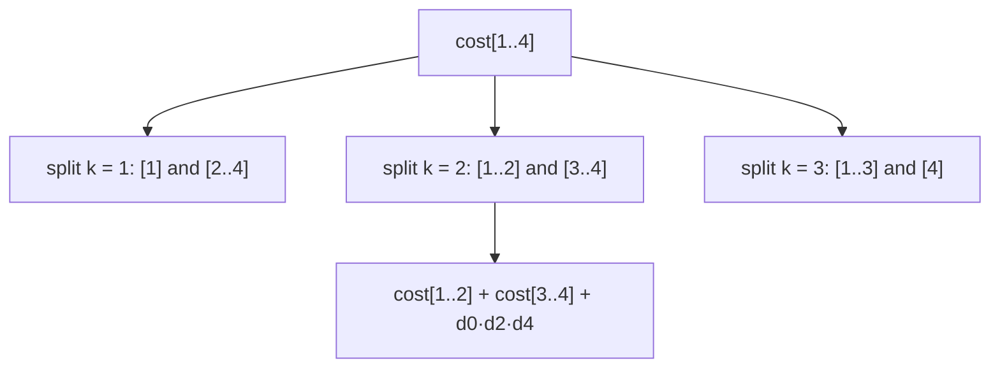
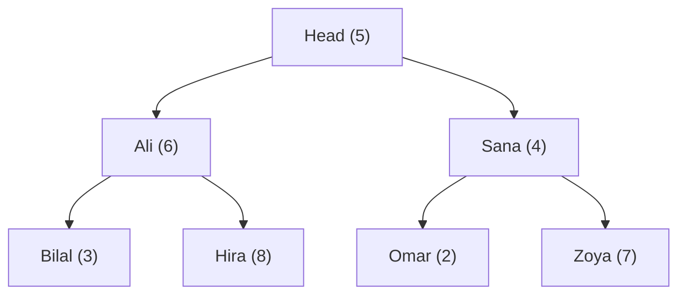

# Session 3 · Advanced DP Patterns

Prepared by **Hamna Zahid Khan**, Junior Lecturer

[🏠 Course home](../README.md) · [📘 Module overview](./README.md) · [⬅ Previous](./session-02-classic-dp-problems.md) · [Practice test ➡](./practice-test.md)

> **Module 16 · Dynamic Programming** · ⏱ 3 hours (90 min lecture + 90 min lab)

## 🎯 Learning objectives

1. Recognise four advanced DP families: **interval DP**, **bitmask DP**, **DP on trees** and **DP over sorted events**.
2. Solve **matrix-chain multiplication** and recover the optimal parenthesisation.
3. Solve a small **travelling salesperson** instance with states (visited set, current city).
4. Compute a tree DP with "include / exclude" states in one post-order pass.
5. Solve **weighted interval scheduling** with DP + binary search and contrast it with greedy.

---

## 1. Choosing the state is the whole game

All DP problems follow the same recipe (Session 1). What changes between families is **what the state remembers**:

| Family | State remembers | Typical order | Example |
|---|---|---|---|
| Linear | a prefix: first i items | i increasing | house robber, LIS |
| Two sequences | two prefixes (i, j) | row by row | LCS, edit distance |
| **Interval** | a contiguous range [i, j] | by **length** of the range | matrix chain, palindromes |
| **Bitmask** | a **set** of items used, as bits | by mask value | TSP, assignment |
| **Tree** | a subtree + a small flag | **post-order** | max independent set |
| **Sorted events** | events sorted by time + "last compatible" | by end time | weighted interval scheduling |

> 🧩 **Analogy: planning a multi-stop trip.** If you only remember "how many stops so far", you cannot know where you are allowed to go next. You must remember **which** places you have visited and **where you are now**. Choosing the state is deciding exactly what you need to remember, and nothing more.

## 2. Interval DP: matrix-chain multiplication

Multiplying a p × q matrix by a q × r matrix costs p·q·r scalar multiplications. Matrix multiplication is associative, so the **order** (parenthesisation) is ours to choose, and it matters enormously.

| Step | Matrix chain M₁ … Mₙ (Mᵢ is dᵢ₋₁ × dᵢ) |
|---|---|
| State | `cost[i][j]` = cheapest way to multiply Mᵢ … Mⱼ |
| Recurrence | `min over k in [i, j) of cost[i][k] + cost[k+1][j] + dᵢ₋₁ · dₖ · dⱼ` |
| Base | `cost[i][i] = 0` |
| Order | by chain **length** 2, 3, …, n (short ranges first) |
| Answer | `cost[1][n]`; `split[i][j]` rebuilds the parentheses |



For dimensions 10 × 30, 30 × 5, 5 × 60, 60 × 10: left-to-right costs 10,500; the best order **((M1 × M2) × (M3 × M4))** costs **5,000**.

Interval DP also solves longest palindromic subsequence, optimal BST construction, burst balloons and polygon triangulation.

## 3. Bitmask DP: travelling salesperson

Visit every city exactly once and return home with minimum total distance. Brute force tries (n − 1)! tours. Bitmask DP remembers **the set of visited cities** as an integer whose bit v is 1 if city v was visited:

| Step | TSP |
|---|---|
| State | `dp[mask][v]` = shortest path that starts at 0, visits exactly the cities in `mask`, and ends at v |
| Recurrence | `dp[mask \| 1<<u][u] = min(…, dp[mask][v] + d[v][u])` for u not in mask |
| Base | `dp[1][0] = 0` (only city 0 visited) |
| Answer | `min over v of dp[all][v] + d[v][0]` |

| n | (n − 1)! tours | 2ⁿ · n states | work 2ⁿ · n² |
|---|---|---|---|
| 5 | 24 | 160 | 800 |
| 10 | 362,880 | 10,240 | 102,400 |
| 20 | 1.2 × 10¹⁷ | 2.1 × 10⁷ | 4.2 × 10⁸ |

Still exponential, but n = 20 becomes feasible. Bit tricks: `mask & (1 << v)` tests membership, `mask | (1 << u)` adds u.

## 4. DP on trees

**Department party:** staff form a tree (each person's manager is the parent). Inviting someone together with their **direct** manager is awkward. Each person has a "fun" score; maximise the total.

Each node returns **two** numbers computed from its children (post-order, Module 09):

| State | Meaning | Recurrence |
|---|---|---|
| `with[v]` | best in v's subtree if v is invited | fun[v] + Σ `without[child]` |
| `without[v]` | best if v is not invited | Σ max(`with[child]`, `without[child]`) |



| Node | with | without |
|---|---|---|
| Bilal, Hira, Omar, Zoya (leaves) | 3, 8, 2, 7 | 0 |
| Ali | 6 + 0 + 0 = 6 | 3 + 8 = 11 |
| Sana | 4 + 0 + 0 = 4 | 2 + 7 = 9 |
| Head | 5 + 11 + 9 = **25** | max(6, 11) + max(4, 9) = 20 |

Answer **25**: Head, Bilal, Hira, Omar, Zoya. One pass, O(n).

## 5. Weighted interval scheduling

Freelance jobs have start, end and **pay**. Maximise total pay with no overlaps. Earliest-finish greedy (Module 15) maximises the **count**, not the pay.

| Step | Weighted intervals (sorted by end) |
|---|---|
| State | `dp[i]` = best pay using the first i jobs |
| Recurrence | `dp[i] = max(dp[i−1], payᵢ + dp[p(i)])` |
| p(i) | number of jobs that end by job i's start (binary search) |
| Time | O(n log n) |

| Method | Result on the program's jobs |
|---|---|
| greedy earliest finish | website + data + audit = 160 |
| **DP** | app + audit = **240** |

## 6. Complexity table

| Problem | States | Transition | Time | Space |
|---|---|---|---|---|
| Matrix chain / interval DP | n² | O(n) splits | O(n³) | O(n²) |
| Longest palindromic subsequence | n² | O(1) | O(n²) | O(n²) |
| TSP bitmask | 2ⁿ · n | O(n) | O(2ⁿ n²) | O(2ⁿ n) |
| Tree DP (include/exclude) | 2n | O(children) | O(n) | O(h) recursion |
| Weighted intervals | n | O(log n) search | O(n log n) | O(n) |

---

## 7. Complete program

📄 **[`src/AdvancedDP.java`](src/AdvancedDP.java)**

```java
import java.util.ArrayList;
import java.util.Arrays;
import java.util.Comparator;
import java.util.List;

/**
 * Session 3 demo: advanced dynamic-programming patterns. Interval DP (matrix-chain multiplication
 * with the optimal parenthesisation), bitmask DP (travelling salesperson over a few campuses),
 * DP on trees (maximum-value guest list with no direct manager-report pairs), and weighted interval
 * scheduling (DP + binary search) compared with the greedy rule from Module 15.
 *
 * Compile:  javac -d out AdvancedDP.java
 * Run:      java -cp out AdvancedDP
 *
 * Prepared by Hamna Zahid Khan, Junior Lecturer
 */
public class AdvancedDP {

    // ---------- interval DP ----------
    /** dims has n+1 entries; matrix i is dims[i] x dims[i+1]. cost[i][j] = min multiplications for i..j. */
    static long matrixChain(int[] dims, int[][] split) {
        int n = dims.length - 1;
        long[][] cost = new long[n][n];
        for (int len = 2; len <= n; len++)                      // solve short chains before long ones
            for (int i = 0; i + len - 1 < n; i++) {
                int j = i + len - 1;
                cost[i][j] = Long.MAX_VALUE;
                for (int k = i; k < j; k++) {                   // last multiplication splits at k
                    long c = cost[i][k] + cost[k + 1][j] + (long) dims[i] * dims[k + 1] * dims[j + 1];
                    if (c < cost[i][j]) { cost[i][j] = c; split[i][j] = k; }
                }
            }
        return cost[0][n - 1];
    }

    static String parens(int[][] split, int i, int j) {
        if (i == j) return "M" + (i + 1);
        return "(" + parens(split, i, split[i][j]) + " x " + parens(split, split[i][j] + 1, j) + ")";
    }

    // ---------- bitmask DP ----------
    /** Shortest tour visiting every city once and returning to city 0. dp[mask][v]: visited set, ending at v. */
    static int tsp(int[][] d, int[] tourOut) {
        int n = d.length, FULL = 1 << n, INF = Integer.MAX_VALUE / 2;
        int[][] dp = new int[FULL][n], parent = new int[FULL][n];
        for (int[] row : dp) Arrays.fill(row, INF);
        dp[1][0] = 0;
        for (int mask = 1; mask < FULL; mask++)
            for (int v = 0; v < n; v++) {
                if (dp[mask][v] >= INF || (mask & (1 << v)) == 0) continue;
                for (int u = 0; u < n; u++) {
                    if ((mask & (1 << u)) != 0) continue;      // already visited
                    int nm = mask | (1 << u), c = dp[mask][v] + d[v][u];
                    if (c < dp[nm][u]) { dp[nm][u] = c; parent[nm][u] = v; }
                }
            }
        int best = INF, last = -1;
        for (int v = 1; v < n; v++) if (dp[FULL - 1][v] + d[v][0] < best) { best = dp[FULL - 1][v] + d[v][0]; last = v; }
        int mask = FULL - 1;
        for (int k = n - 1; k >= 1; k--) { tourOut[k] = last; int p = parent[mask][last]; mask ^= 1 << last; last = p; }
        tourOut[0] = 0;
        return best;
    }

    // ---------- DP on trees ----------
    /** Max total "fun" of invited staff such that no one is invited together with their direct manager. */
    static int[] party(int v, List<List<Integer>> reports, int[] fun) {
        int with = fun[v], without = 0;                          // {best if v invited, best if not}
        for (int c : reports.get(v)) {
            int[] r = party(c, reports, fun);
            with += r[1];                                        // v invited -> child cannot be
            without += Math.max(r[0], r[1]);                     // v not invited -> child free
        }
        return new int[]{with, without};
    }

    // ---------- weighted interval scheduling ----------
    record Job(String name, int start, int end, int pay) { }

    static int weightedSchedule(List<Job> jobs, List<String> chosen) {
        List<Job> s = new ArrayList<>(jobs);
        s.sort(Comparator.comparingInt(Job::end));
        int n = s.size();
        int[] dp = new int[n + 1], p = new int[n];
        for (int i = 0; i < n; i++) {                            // p[i] = number of jobs ending by start of job i
            int lo = 0, hi = i;
            while (lo < hi) { int mid = (lo + hi) / 2; if (s.get(mid).end() <= s.get(i).start()) lo = mid + 1; else hi = mid; }
            p[i] = lo;
        }
        for (int i = 1; i <= n; i++)
            dp[i] = Math.max(dp[i - 1], s.get(i - 1).pay() + dp[p[i - 1]]);   // skip job i, or take it
        for (int i = n; i > 0; ) {
            if (dp[i] == dp[i - 1]) i--;
            else { chosen.add(0, s.get(i - 1).name()); i = p[i - 1]; }
        }
        return dp[n];
    }

    public static void main(String[] args) {
        System.out.println("== Interval DP: matrix-chain multiplication ==");
        int[] dims = {10, 30, 5, 60, 10};                        // M1 10x30, M2 30x5, M3 5x60, M4 60x10
        int[][] split = new int[4][4];
        long best = matrixChain(dims, split);
        System.out.println("dims " + Arrays.toString(dims) + " -> best order " + parens(split, 0, 3) + " = " + best + " multiplications");
        long leftToRight = 10L * 30 * 5 + 10L * 5 * 60 + 10L * 60 * 10;
        System.out.println("left to right ((M1 x M2) x M3) x M4 = " + leftToRight + " multiplications");

        System.out.println("\n== Bitmask DP: shortest tour of 5 campuses (km) ==");
        String[] campus = {"Main", "North", "City", "East", "Port"};
        int[][] d = {
            {0, 12, 10, 19, 8},
            {12, 0, 3, 7, 2},
            {10, 3, 0, 6, 20},
            {19, 7, 6, 0, 4},
            {8, 2, 20, 4, 0}};
        int[] tour = new int[5];
        int len = tsp(d, tour);
        StringBuilder sb = new StringBuilder();
        for (int v : tour) sb.append(campus[v]).append(" -> ");
        System.out.println("tour " + sb + "Main = " + len + " km  (states: 2^5 x 5 = 160)");

        System.out.println("\n== DP on a tree: department party ==");
        String[] staff = {"Head", "Ali", "Sana", "Bilal", "Hira", "Omar", "Zoya"};
        int[] fun = {5, 6, 4, 3, 8, 2, 7};
        List<List<Integer>> rep = new ArrayList<>();
        for (int i = 0; i < staff.length; i++) rep.add(new ArrayList<>());
        rep.get(0).addAll(List.of(1, 2));                        // Head manages Ali, Sana
        rep.get(1).addAll(List.of(3, 4));                        // Ali manages Bilal, Hira
        rep.get(2).addAll(List.of(5, 6));                        // Sana manages Omar, Zoya
        int[] r = party(0, rep, fun);
        System.out.println("fun: " + Arrays.toString(fun) + " for " + Arrays.toString(staff));
        System.out.println("best with Head = " + r[0] + ", without Head = " + r[1] + " -> answer " + Math.max(r[0], r[1]));

        System.out.println("\n== Weighted interval scheduling: freelance jobs ==");
        List<Job> jobs = List.of(new Job("website", 1, 4, 50), new Job("logo", 3, 5, 20), new Job("app", 0, 6, 200),
                new Job("data", 4, 7, 70), new Job("report", 5, 9, 60), new Job("audit", 7, 10, 40));
        List<String> chosen = new ArrayList<>();
        int pay = weightedSchedule(jobs, chosen);
        System.out.println("DP: max pay = " + pay + " with " + chosen);
        List<Job> byEnd = new ArrayList<>(jobs);
        byEnd.sort(Comparator.comparingInt(Job::end));
        int greedyPay = 0, lastEnd = Integer.MIN_VALUE;
        List<String> g = new ArrayList<>();
        for (Job j : byEnd) if (j.start() >= lastEnd) { greedyPay += j.pay(); lastEnd = j.end(); g.add(j.name()); }
        System.out.println("greedy earliest-finish (ignores pay): " + greedyPay + " with " + g);
    }
}
```

**Real output:**

```text
$ java -cp out AdvancedDP
== Interval DP: matrix-chain multiplication ==
dims [10, 30, 5, 60, 10] -> best order ((M1 x M2) x (M3 x M4)) = 5000 multiplications
left to right ((M1 x M2) x M3) x M4 = 10500 multiplications

== Bitmask DP: shortest tour of 5 campuses (km) ==
tour Main -> Port -> East -> North -> City -> Main = 32 km  (states: 2^5 x 5 = 160)

== DP on a tree: department party ==
fun: [5, 6, 4, 3, 8, 2, 7] for [Head, Ali, Sana, Bilal, Hira, Omar, Zoya]
best with Head = 25, without Head = 20 -> answer 25

== Weighted interval scheduling: freelance jobs ==
DP: max pay = 240 with [app, audit]
greedy earliest-finish (ignores pay): 160 with [website, data, audit]
```

---

## 8. Worked examples (basic → advanced)

**Example 1 (basic): longest palindromic subsequence (interval DP).** `dp[i][j]` = longest palindromic subsequence inside s[i..j]. Equal ends add 2 to the inside; otherwise drop one end. Fill i from right to left so `dp[i+1][…]` is ready.

```java
/** Longest palindromic subsequence: interval DP over substrings s[i..j]. */
static int longestPalSubseq(String s) {
    int n = s.length();
    int[][] dp = new int[n][n];
    for (int i = n - 1; i >= 0; i--) {
        dp[i][i] = 1;
        for (int j = i + 1; j < n; j++)
            dp[i][j] = s.charAt(i) == s.charAt(j) ? dp[i + 1][j - 1] + 2 : Math.max(dp[i + 1][j], dp[i][j - 1]);
    }
    return n == 0 ? 0 : dp[0][n - 1];
}
```
<sub>Full, compiled version: [`src/Labs16.java`](src/Labs16.java)</sub>

"bbbab" → 4 ("bbbb"); "character" → 5 ("carac").

**Example 2 (intermediate): word break.** Can "datastructures" be split into dictionary words? `ok[i]` = the prefix of length i can be split; it is true if some `ok[j]` is true and s[j..i) is a word.

```java
/** Can s be segmented into dictionary words? ok[i] = some ok[j] with s[j..i) in the dictionary. */
static boolean wordBreak(String s, List<String> dict) {
    Set<String> words = new HashSet<>(dict);
    boolean[] ok = new boolean[s.length() + 1];
    ok[0] = true;
    for (int i = 1; i <= s.length(); i++)
        for (int j = 0; j < i && !ok[i]; j++)
            ok[i] = ok[j] && words.contains(s.substring(j, i));
    return ok[s.length()];
}
```
<sub>Full, compiled version: [`src/Labs16.java`](src/Labs16.java)</sub>

"datastructures" with {data, struct, structures, ures} → true; "catsandog" → false.

**Example 3 (advanced): reading a TSP tour.** The program's distances give the tour **Main → Port → East → North → City → Main = 32 km** (8 + 4 + 7 + 3 + 10). The `parent[mask][v]` table is walked backwards from the best final city, removing each city's bit from the mask, exactly like path reconstruction in Session 1.

## 9. Real-life problem: scheduling paid weekend workshops

**Problem.** A training centre receives requests to run weekend workshops in its single lab. Each request has a time slot and a fee; long corporate workshops pay much more than short student sessions. Which requests should be accepted to maximise income?

**Solution.** Weighted interval scheduling: sort by end time, binary-search each request's last compatible request, and fill `dp[i] = max(dp[i−1], fee + dp[p(i)])`. O(n log n) for hundreds of requests, and the reconstruction lists the accepted bookings. The "accept as many as possible" greedy rule would favour many short student sessions and could lose most of the income, exactly as the program shows (160 vs 240).

## 10. Common mistakes

| Mistake | Fix |
|---|---|
| Interval DP filled by i then j (reads unfinished ranges) | fill by **length**, or i descending and j ascending |
| Bitmask DP with n = 30 | 2³⁰ · 30 states is too many; bitmask DP is for n ≤ ~20 |
| Tree DP with a single value per node | keep separate states (include / exclude) |
| Weighted intervals solved greedily | DP: greedy ignores weights |
| `1 << n` overflow for n ≥ 31 | use `long` masks or keep n small |
| Forgetting to return home in TSP | add `d[v][0]` at the end |

## 11. Best practices

- Ask "what must I remember to decide the next step?" and put exactly that in the state.
- Estimate states × transitions before coding; it tells you which family is feasible.
- For trees, return small arrays (`int[]{with, without}`) from the recursive call.
- Keep reconstruction tables (`split`, `parent`, `prev`) alongside value tables.

---

## 12. Lab tasks

**Lab 3.1: Longest palindromic subsequence.**

<details>
<summary>✅ Solution</summary>

See Example 1.

</details>

**Lab 3.2: Word break.**

<details>
<summary>✅ Solution</summary>

See Example 2.

</details>

**Lab 3.3: Matrix chain by hand.** For dimensions [5, 10, 3, 12, 5], fill the cost table and find the best order.

<details>
<summary>✅ Solution</summary>

Length 2: M1M2 = 5·10·3 = 150, M2M3 = 10·3·12 = 360, M3M4 = 3·12·5 = 180. Length 3: M1..M3 = min(0 + 360 + 5·10·12 = 960, 150 + 0 + 5·3·12 = 330) = 330; M2..M4 = min(0 + 180 + 10·3·5 = 330, 360 + 0 + 10·12·5 = 960) = 330. Length 4: min(k=1: 0 + 330 + 5·10·5 = 580, k=2: 150 + 180 + 5·3·5 = 405, k=3: 330 + 0 + 5·12·5 = 630) = **405** with order **(M1 × M2) × (M3 × M4)**.

</details>

**Lab 3.4: Tree DP variant.** In the party problem, suppose the Head **must** attend. What is the best total?

<details>
<summary>✅ Solution</summary>

Return `with[Head]` instead of the maximum: **25** (it happens to be the overall optimum too). If the Head must **not** attend, the answer is `without[Head]` = 20.

</details>

**Real output of the Session 3 lab solutions:**

```text
$ java -cp out Labs16 3
-- Session 3 labs --
longestPalSubseq("bbbab") = 4, ("character") = 5
wordBreak("datastructures") = true, wordBreak("catsandog") = false
```

---

## 13. Quiz

**Q1.** Interval DP tables are typically filled in order of:

- **A.** the left index only
- **B.** increasing interval length
- **C.** random order
- **D.** decreasing value

**Q2.** In bitmask TSP, the state dp[mask][v] records:

- **A.** only the number of visited cities
- **B.** the set of visited cities and the current city
- **C.** the remaining distance
- **D.** the order of all cities

**Q3.** Bitmask DP is practical for roughly:

- **A.** n ≤ 20
- **B.** n ≤ 1,000
- **C.** n ≤ 10⁶
- **D.** any n

**Q4.** In the tree "party" DP, if a node is invited its children must be:

- **A.** invited
- **B.** not invited
- **C.** either
- **D.** removed from the tree

**Q5.** Weighted interval scheduling is solved optimally by:

- **A.** earliest finish greedy
- **B.** highest pay first greedy
- **C.** DP over jobs sorted by end time
- **D.** BFS

<details>
<summary><b>Show answers</b></summary>

1. **B**: Shorter ranges are needed by longer ones.
2. **B**: Which and where.
3. **A**: 2ⁿ states.
4. **B**: No manager-report pairs.
5. **C**: dp[i] = max(skip, take + dp[p(i)]).

</details>

---

## 14. Summary

- Choosing the **state** defines the DP family: prefix, two prefixes, interval, bitmask, tree, sorted events.
- **Interval DP** (matrix chain, palindromes) fills by length; **bitmask DP** (TSP) handles sets for n ≤ 20.
- **Tree DP** returns include/exclude values in one post-order pass.
- **Weighted intervals** need DP; greedy only maximises the count.

## 15. Viva / interview questions

1. Why must matrix-chain DP be filled by length?
2. How many states and transitions does bitmask TSP have, and why is that better than n!?
3. Extend the party DP to "no two invited people within distance 2 in the tree".
4. Why does weighted interval scheduling need binary search for p(i)?
5. What is the "burst balloons" problem and why is it interval DP?
6. How would you solve the assignment problem (n workers, n jobs) with bitmask DP?

---

[⬅ Previous](./session-02-classic-dp-problems.md) · [📘 Module overview](./README.md) · [Practice test ➡](./practice-test.md)
