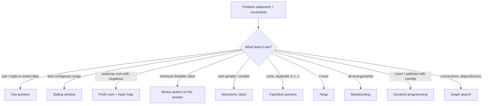

# Module 17 · Interview Problem Patterns

Prepared by **Hamna Zahid Khan**, Junior Lecturer

[🏠 Course home](../README.md)

> ⏱ 6 contact hours · 2 sessions · 🟣 Career

The final module turns the course into a problem-solving toolkit. It teaches two-pointer and sliding-window techniques in depth, then fast/slow pointers, binary search on the answer, prefix sums, monotonic stacks, cyclic sort and bit tricks, and ends with a decision guide that maps problem statements and constraints to the right pattern.

## 🎯 Module objectives

- Recognise the common interview patterns from a problem statement and its constraints.
- Apply opposite-end and reader/writer pointers; fixed and variable sliding windows.
- Use fast/slow pointers, binary search on the answer, cyclic sort and XOR tricks.
- Follow a structured interview routine and test solutions against brute force.

## 📚 Sessions

| # | Session | Key ideas | Code |
|---|---|---|---|
| 1 | [Two Pointers and Sliding Window](session-01-two-pointers-and-sliding-window.md) | pair/3-sum, water container, in-place filtering, windows | [`TwoPointersWindow.java`](src/TwoPointersWindow.java) |
| 2 | [More Patterns](session-02-more-patterns.md) | Floyd, binary search on answer, monotonic stack, cyclic sort, bits, decision guide | [`MorePatterns.java`](src/MorePatterns.java) |
| ✍️ | [Practice test](practice-test.md) | 20 MCQs + 3 coding scenarios | [`Labs17.java`](src/Labs17.java), [`SelfCheck.java`](src/SelfCheck.java) |

## 🗺️ Concept map



## 📄 One-page cheat sheet

| Pattern | Template idea | Time |
|---|---|---|
| Opposite pointers | `while (i < j)`: move the side that fixes the comparison | O(n) |
| Reader/writer | `if (keep(a[r])) a[w++] = a[r]` | O(n) |
| Fixed window | `sum += a[i] − a[i − k]` | O(n) |
| Variable window | expand right; `while (invalid) shrink left`; record | O(n) |
| Fast/slow | slow 1 step, fast 2 steps; restart to find entrance | O(n) |
| Binary search on answer | `if (feasible(mid)) hi = mid; else lo = mid + 1;` | O(n log R) |
| Prefix + hash | `count += seen.getOrDefault(sum − k, 0)` | O(n) |
| Monotonic stack | pop while top is smaller than current | O(n) |
| Cyclic sort | swap a[i] to index a[i] − 1 until home | O(n) |
| XOR | `x ^= v` cancels pairs | O(n) |

**Constraint guide:** n ≤ 20 → exponential · n ≤ 500 → O(n³) · n ≤ 5,000 → O(n²) · n ≤ 10⁶ → O(n log n) · larger → O(n).

## ▶️ Run the code

```bash
cd 17-interview-problem-patterns/src
javac -d out *.java
java -ea -cp out SelfCheck
java -cp out TwoPointersWindow
java -cp out Labs17 1          # Session 1 lab solutions (2 for Session 2)
```

See [`src/README.md`](src/README.md) for every file.
