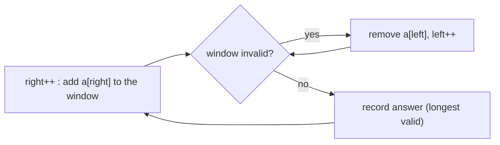

# Session 1 · Two Pointers and Sliding Window

Prepared by **Hamna Zahid Khan**, Junior Lecturer

[🏠 Course home](../README.md) · [📘 Module overview](./README.md) · [⬅ Module overview](./README.md) · [Next ➡](./session-02-more-patterns.md)

> **Module 17 · Interview Problem Patterns** · ⏱ 3 hours (90 min lecture + 90 min lab)

## 🎯 Learning objectives

1. Recognise problems that the **two-pointer** pattern turns from O(n²) into O(n).
2. Use **opposite-end** pointers on sorted data (pair sum, 3-sum, container with most water) and justify each pointer move.
3. Use **same-direction** (reader/writer) pointers to modify arrays in place.
4. Apply **fixed-size** and **variable-size sliding windows** with the expand/shrink template.
5. Read a problem statement and pick the right pattern quickly, as in a coding interview.

---

## 1. Why patterns?

Interview and contest problems look endless, but most solutions reuse about a dozen patterns. Recognising the pattern is usually the hardest step; the code is short once you have it.

> 🧵 **Analogy: two people searching a sorted bookshelf.** To find two books whose prices add up to exactly Rs 900, one person starts at the cheap end and one at the expensive end. If the pair costs too much, the expensive-end person steps left; if too little, the cheap-end person steps right. Neither ever needs to walk back, so the shelf is scanned once.

| Signal in the problem | Likely pattern |
|---|---|
| sorted array, pair/triple with a target sum | opposite-end two pointers |
| "in place", "remove duplicates", "partition" | reader/writer pointers |
| "contiguous subarray/substring" + longest/shortest/max | sliding window |
| "every window of size k" | fixed window |
| linked list cycle, middle, duplicate in 1..n | fast/slow pointers (Session 2) |

## 2. Opposite-end pointers

Start `i = 0`, `j = n − 1` and move them toward each other. Each step **discards** one candidate permanently, so there are at most n steps.

**Pair sum in a sorted array (target 900):**

| i | j | a[i] + a[j] | Decision |
|---|---|---|---|
| 0 (120) | 7 (800) | 920 | too big ⇒ j−− (800 cannot pair with anything ≥ 120) |
| 0 (120) | 6 (650) | 770 | too small ⇒ i++ (120 cannot pair with anything ≤ 650) |
| 1 (250) | 6 (650) | **900** | found |

**Why it is correct:** if a[i] + a[j] > target, then a[k] + a[j] > target for every k ≥ i, so a[j] can be discarded. Symmetrically for "too small".

**Container with most water:** area = min(h[i], h[j]) × (j − i). Always move the **shorter** line: keeping it can never give a larger area, because width shrinks and the height is capped by that shorter line.

**3-sum:** sort, fix the first element, then run pair-sum on the rest: O(n²) instead of O(n³). Skip equal neighbours to avoid duplicate triples.

## 3. Same-direction pointers (reader/writer)

A fast **reader** scans every element; a slow **writer** marks where the next kept element goes. Useful for in-place filtering with O(1) extra space.

| r | a[r] | keep? | w after | array prefix |
|---|---|---|---|---|
| 1 | 101 | no (dup) | 1 | 101 |
| 2 | 102 | yes | 2 | 101 102 |
| 3 | 105 | yes | 3 | 101 102 105 |
| 4, 5 | 105 | no | 3 | |
| 6 | 108 | yes | 4 | 101 102 105 108 |

## 4. Sliding window

A window [left, right] over an array or string. Instead of recomputing each window from scratch (O(n·k) or O(n²)), **update** the window's summary as it slides.

### Fixed window (size k)

```java
for (int i = k; i < n; i++) { sum += a[i] - a[i - k]; best = Math.max(best, sum); }
```

### Variable window: expand right, shrink left



For **shortest** windows, record the answer **inside** the shrink loop (while the window is still valid); for **longest** windows, record **after** shrinking.

| Problem | Window invalid when | Summary kept |
|---|---|---|
| longest substring without repeats | a character repeats | last index of each char |
| shortest subarray with sum ≥ target (positive values) | (shrink while valid) | running sum |
| longest with at most k distinct | more than k distinct | count map |
| minimum window containing all chars of t | (shrink while all present) | need counts + missing |

### Dry run: longest substring without repeating characters, "pwwkew"

| right | char | left (after) | window | best |
|---|---|---|---|---|
| 0 | p | 0 | p | p |
| 1 | w | 0 | pw | pw |
| 2 | w | 2 (jump past old w) | w | pw |
| 3 | k | 2 | wk | pw |
| 4 | e | 2 | wke | **wke** |
| 5 | w | 3 (jump past w at 2) | kew | wke |

Each index enters and leaves the window at most once ⇒ **O(n)**.

**Requirement:** variable windows need **monotonicity**: extending a window must never make an invalid window valid again by shrinking the left side incorrectly. With negative numbers, "sum ≥ target" is not monotone; use prefix sums + hashing (Module 08) instead.

## 5. Complexity table

| Problem | Brute force | Pattern | Time | Space |
|---|---|---|---|---|
| Pair sum (sorted) | O(n²) | opposite pointers | O(n) | O(1) |
| 3-sum | O(n³) | sort + pointers | O(n²) | O(1) extra |
| Container with most water | O(n²) | opposite pointers | O(n) | O(1) |
| Remove duplicates in place | O(n) extra array | reader/writer | O(n) | O(1) |
| Max sum of k consecutive | O(n·k) | fixed window | O(n) | O(1) |
| Longest unique substring | O(n²)-O(n³) | variable window | O(n) | O(σ) |
| Min window substring | O(n²·σ) | variable window | O(n + m) | O(σ) |

---

## 6. Complete program

📄 **[`src/TwoPointersWindow.java`](src/TwoPointersWindow.java)**

```java
import java.util.ArrayList;
import java.util.Arrays;
import java.util.HashMap;
import java.util.List;
import java.util.Map;

/**
 * Session 1 demo: the two-pointer and sliding-window patterns. Opposite-end pointers (pair sum,
 * container with most water, 3-sum), same-direction pointers (in-place deduplication), fixed windows
 * (best k-day total) and variable windows (longest unique substring, shortest window with sum >= target,
 * longest window with at most k distinct values), each compared with its brute force.
 *
 * Compile:  javac -d out TwoPointersWindow.java
 * Run:      java -cp out TwoPointersWindow
 *
 * Prepared by Hamna Zahid Khan, Junior Lecturer
 */
public class TwoPointersWindow {
    static long steps;

    /** Sorted array: indices of two values summing to target. Move the pointer that fixes the sum. */
    static int[] pairSum(int[] a, int target) {
        int i = 0, j = a.length - 1;
        while (i < j) {
            steps++;
            int s = a[i] + a[j];
            if (s == target) return new int[]{i, j};
            if (s < target) i++; else j--;          // too small: need a bigger left value
        }
        return null;
    }

    /** Remove duplicates from a sorted array in place; returns the new length. Slow writer, fast reader. */
    static int dedupe(int[] a) {
        if (a.length == 0) return 0;
        int w = 1;
        for (int r = 1; r < a.length; r++) if (a[r] != a[w - 1]) a[w++] = a[r];
        return w;
    }

    /** Max water between two lines: always move the shorter line inward. O(n). */
    static int maxWater(int[] h) {
        int i = 0, j = h.length - 1, best = 0;
        while (i < j) {
            best = Math.max(best, Math.min(h[i], h[j]) * (j - i));
            if (h[i] < h[j]) i++; else j--;
        }
        return best;
    }

    /** All unique triples summing to 0: sort, fix one value, two-pointer the rest. O(n^2). */
    static List<List<Integer>> threeSum(int[] in) {
        int[] a = in.clone();
        Arrays.sort(a);
        List<List<Integer>> out = new ArrayList<>();
        for (int k = 0; k < a.length - 2; k++) {
            if (k > 0 && a[k] == a[k - 1]) continue;           // skip duplicate anchors
            int i = k + 1, j = a.length - 1;
            while (i < j) {
                int s = a[k] + a[i] + a[j];
                if (s == 0) {
                    out.add(List.of(a[k], a[i], a[j]));
                    while (i < j && a[i] == a[i + 1]) i++;
                    while (i < j && a[j] == a[j - 1]) j--;
                    i++; j--;
                } else if (s < 0) i++; else j--;
            }
        }
        return out;
    }

    /** Fixed window: best total of k consecutive days. Slide: add the new day, drop the old one. */
    static int bestWindow(int[] a, int k) {
        int sum = 0;
        for (int i = 0; i < k; i++) sum += a[i];
        int best = sum;
        for (int i = k; i < a.length; i++) {
            sum += a[i] - a[i - k];
            best = Math.max(best, sum);
        }
        return best;
    }

    /** Variable window: longest substring with no repeated character. */
    static String longestUnique(String s) {
        Map<Character, Integer> last = new HashMap<>();
        int left = 0, bestL = 0, bestLen = 0;
        for (int right = 0; right < s.length(); right++) {
            char c = s.charAt(right);
            if (last.containsKey(c) && last.get(c) >= left) left = last.get(c) + 1;   // jump past the repeat
            last.put(c, right);
            if (right - left + 1 > bestLen) { bestLen = right - left + 1; bestL = left; }
        }
        return s.substring(bestL, bestL + bestLen);
    }

    /** Variable window: shortest subarray (positive values) with sum >= target; 0 if none. */
    static int shortestAtLeast(int[] a, int target) {
        int left = 0, sum = 0, best = Integer.MAX_VALUE;
        for (int right = 0; right < a.length; right++) {
            sum += a[right];
            while (sum >= target && left <= right) {         // shrink while still valid
                best = Math.min(best, right - left + 1);
                sum -= a[left++];
            }
        }
        return best == Integer.MAX_VALUE ? 0 : best;
    }

    /** Variable window: longest stretch with at most k distinct values (e.g. fruit baskets). */
    static int longestAtMostK(int[] a, int k) {
        Map<Integer, Integer> count = new HashMap<>();
        int left = 0, best = 0;
        for (int right = 0; right < a.length; right++) {
            count.merge(a[right], 1, Integer::sum);
            while (count.size() > k) {
                if (count.merge(a[left], -1, Integer::sum) == 0) count.remove(a[left]);
                left++;
            }
            best = Math.max(best, right - left + 1);
        }
        return best;
    }

    public static void main(String[] args) {
        System.out.println("== Opposite-end pointers ==");
        int[] prices = {120, 250, 310, 400, 480, 520, 650, 800};
        steps = 0;
        System.out.println("two books costing exactly 900 from " + Arrays.toString(prices) + " -> indices "
                + Arrays.toString(pairSum(prices, 900)) + " in " + steps + " steps (brute force: up to 28 pairs)");
        System.out.println("maxWater([1, 8, 6, 2, 5, 4, 8, 3, 7]) = " + maxWater(new int[]{1, 8, 6, 2, 5, 4, 8, 3, 7}));
        System.out.println("threeSum([-1, 0, 1, 2, -1, -4]) = " + threeSum(new int[]{-1, 0, 1, 2, -1, -4}));

        System.out.println("\n== Same-direction pointers ==");
        int[] rolls = {101, 101, 102, 105, 105, 105, 108};
        int n = dedupe(rolls);
        System.out.println("dedupe -> length " + n + ", prefix " + Arrays.toString(Arrays.copyOf(rolls, n)));

        System.out.println("\n== Fixed window ==");
        int[] visitors = {40, 55, 30, 70, 65, 20, 90, 85};
        System.out.println("best 3-day visitor total in " + Arrays.toString(visitors) + " = " + bestWindow(visitors, 3));

        System.out.println("\n== Variable windows ==");
        for (String s : new String[]{"abcabcbb", "pwwkew", "datastructures"})
            System.out.println("longestUnique(\"" + s + "\") = \"" + longestUnique(s) + "\"");
        System.out.println("shortestAtLeast([2, 3, 1, 2, 4, 3], 7) = " + shortestAtLeast(new int[]{2, 3, 1, 2, 4, 3}, 7));
        System.out.println("longestAtMostK([1, 2, 1, 2, 3, 3, 3, 2], k=2) = " + longestAtMostK(new int[]{1, 2, 1, 2, 3, 3, 3, 2}, 2));

        System.out.println("\n== Brute force vs window: longest unique substring of 200,000 chars ==");
        StringBuilder sb = new StringBuilder();
        java.util.Random r = new java.util.Random(17);
        for (int i = 0; i < 200_000; i++) sb.append((char) ('a' + r.nextInt(26)));
        long t0 = System.nanoTime();
        int len = longestUnique(sb.toString()).length();
        long ms = (System.nanoTime() - t0) / 1_000_000;
        System.out.println("window answer length = " + len + " (one pass, " + (ms < 1000 ? "well under a second" : ms + " ms")
                + "); a check of all ~2*10^10 substrings would be infeasible");
    }
}
```

**Real output:**

```text
$ java -cp out TwoPointersWindow
== Opposite-end pointers ==
two books costing exactly 900 from [120, 250, 310, 400, 480, 520, 650, 800] -> indices [1, 6] in 3 steps (brute force: up to 28 pairs)
maxWater([1, 8, 6, 2, 5, 4, 8, 3, 7]) = 49
threeSum([-1, 0, 1, 2, -1, -4]) = [[-1, -1, 2], [-1, 0, 1]]

== Same-direction pointers ==
dedupe -> length 4, prefix [101, 102, 105, 108]

== Fixed window ==
best 3-day visitor total in [40, 55, 30, 70, 65, 20, 90, 85] = 195

== Variable windows ==
longestUnique("abcabcbb") = "abc"
longestUnique("pwwkew") = "wke"
longestUnique("datastructures") = "astruc"
shortestAtLeast([2, 3, 1, 2, 4, 3], 7) = 2
longestAtMostK([1, 2, 1, 2, 3, 3, 3, 2], k=2) = 5

== Brute force vs window: longest unique substring of 200,000 chars ==
window answer length = 20 (one pass, well under a second); a check of all ~2*10^10 substrings would be infeasible
```

---

## 7. Worked examples (basic → advanced)

**Example 1 (basic): valid palindrome.** Ignore case and punctuation; compare characters from both ends.

```java
/** Palindrome check ignoring case and non-alphanumerics: two pointers moving inward. */
static boolean validPalindrome(String s) {
    int i = 0, j = s.length() - 1;
    while (i < j) {
        if (!Character.isLetterOrDigit(s.charAt(i))) { i++; continue; }
        if (!Character.isLetterOrDigit(s.charAt(j))) { j--; continue; }
        if (Character.toLowerCase(s.charAt(i)) != Character.toLowerCase(s.charAt(j))) return false;
        i++; j--;
    }
    return true;
}
```
<sub>Full, compiled version: [`src/Labs17.java`](src/Labs17.java)</sub>

**Example 2 (intermediate): most vowels in a window of k.** A fixed window: add the entering character, remove the leaving one.

```java
/** Most vowels in any window of length k: fixed window with an add/drop update. */
static int maxVowels(String s, int k) {
    String v = "aeiou";
    int cur = 0, best = 0;
    for (int i = 0; i < s.length(); i++) {
        if (v.indexOf(s.charAt(i)) >= 0) cur++;
        if (i >= k && v.indexOf(s.charAt(i - k)) >= 0) cur--;
        best = Math.max(best, cur);
    }
    return best;
}
```
<sub>Full, compiled version: [`src/Labs17.java`](src/Labs17.java)</sub>

"abciiidef", k = 3 → **3** ("iii").

**Example 3 (advanced): minimum window substring.** Shortest part of s containing all characters of t (with repeats). Keep `need[c]` and a `missing` counter; expand until nothing is missing, then shrink while still valid, recording the best.

```java
/** Shortest substring of s containing every character of t (with multiplicity). Variable window. */
static String minWindow(String s, String t) {
    int[] need = new int[128];
    for (char c : t.toCharArray()) need[c]++;
    int missing = t.length(), left = 0, bestL = 0, bestLen = Integer.MAX_VALUE;
    for (int right = 0; right < s.length(); right++) {
        if (need[s.charAt(right)]-- > 0) missing--;          // this char was still needed
        while (missing == 0) {                               // valid window: try to shrink it
            if (right - left + 1 < bestLen) { bestLen = right - left + 1; bestL = left; }
            if (++need[s.charAt(left++)] > 0) missing++;     // dropped a needed char
        }
    }
    return bestLen == Integer.MAX_VALUE ? "" : s.substring(bestL, bestL + bestLen);
}
```
<sub>Full, compiled version: [`src/Labs17.java`](src/Labs17.java)</sub>

| Phase | Window (indices) | missing | Note |
|---|---|---|---|
| expand to C | "ADOBEC" (0..5) | 0 | first valid window, length 6 |
| shrink | drop A | 1 | invalid again |
| expand to A | "DOBECODEBA" (1..10) | 0 | valid |
| shrink | drop D, O, B, E; dropping C breaks it | 1 | best seen: "CODEBA" (5..10), length 6 |
| expand to C | "ODEBANC" (6..12) | 0 | valid |
| shrink | drop O, D, E | 0 | **"BANC" (9..12), length 4** |

"ADOBECODEBANC", t = "ABC" → **"BANC"**.

## 8. Real-life problem: busiest 15-minute period at the campus gate

**Problem.** The security system logs how many people pass the main gate each minute over a day (1,440 values). Administration wants the 15-minute period with the most entries to schedule extra guards, and the shortest period in which at least 500 people entered to understand peak rushes.

**Solution.** Both are window problems on non-negative counts. The busiest 15 minutes is a **fixed window** (add the new minute, drop the minute 15 back), one pass over 1,440 values. The shortest period with ≥ 500 entries is a **variable window** (expand until the sum reaches 500, shrink while it stays ≥ 500). Brute force would check about a million periods; the windows do 1,440 steps each.

## 9. Common mistakes

| Mistake | Fix |
|---|---|
| Two pointers on **unsorted** data for pair sum | sort first, or use a hash set (Module 08) |
| Moving the taller line in container-with-water | move the **shorter** one |
| Duplicate triples in 3-sum | skip equal anchors and equal neighbours after a match |
| Variable window with negative numbers | not monotone: use prefix sums + hash map |
| Recording the answer at the wrong moment (shortest vs longest) | shortest: inside shrink loop; longest: after it |
| `left` jumping **backwards** in longest-unique | only jump if the last occurrence is ≥ left |

## 10. Best practices

- Say the invariant aloud: "everything left of i is too small to pair with anything", "the window never contains a repeat".
- Write the brute force first (it is your test oracle; see `SelfCheck`), then the pattern.
- Keep window state minimal: a sum, a count array of size 128/26, or a map.
- For strings over a small alphabet, arrays (`int[128]`) beat hash maps.

---

## 11. Lab tasks

**Lab 1.1: Valid palindrome.**

<details>
<summary>✅ Solution</summary>

See Example 1.

</details>

**Lab 1.2: Max vowels in a window.**

<details>
<summary>✅ Solution</summary>

See Example 2.

</details>

**Lab 1.3: Minimum window substring.**

<details>
<summary>✅ Solution</summary>

See Example 3.

</details>

**Lab 1.4: Squares of a sorted array.** Given sorted `[-7, -3, 2, 3, 11]`, return the sorted squares in O(n) without sorting again.

<details>
<summary>💡 Hint</summary>

The largest square is at one of the two ends. Fill the result from the back.

</details>

<details>
<summary>✅ Solution</summary>

```java
int[] out = new int[a.length];
for (int i = 0, j = a.length - 1, k = a.length - 1; i <= j; k--) {
    if (Math.abs(a[i]) > Math.abs(a[j])) out[k] = a[i] * a[i++];
    else out[k] = a[j] * a[j--];
}
```

Result: [4, 9, 9, 49, 121]. Opposite pointers, O(n).

</details>

**Real output of the Session 1 lab solutions:**

```text
$ java -cp out Labs17 1
-- Session 1 labs --
validPalindrome("A man, a plan, a canal: Panama") = true, ("race a car") = false
minWindow("ADOBECODEBANC", "ABC") = "BANC"
maxVowels("abciiidef", 3) = 3
```

---

## 12. Quiz

**Q1.** Two pointers find a pair with a target sum in O(n) when the array is:

- **A.** unsorted
- **B.** sorted
- **C.** a linked list only
- **D.** of length ≤ 10

**Q2.** In container with most water, which pointer moves?

- **A.** the taller line
- **B.** the shorter line
- **C.** both always
- **D.** a random one

**Q3.** The fixed-window update for a running sum is:

- **A.** sum = 0 and recompute
- **B.** sum += a[i] − a[i − k]
- **C.** sum *= 2
- **D.** sum += a[i]

**Q4.** A variable sliding window for "shortest subarray with sum ≥ target" requires:

- **A.** negative numbers
- **B.** non-negative numbers (monotone sums)
- **C.** a sorted array
- **D.** a hash map

**Q5.** The time complexity of the longest-substring-without-repeats window is:

- **A.** O(n²)
- **B.** O(n log n)
- **C.** O(n)
- **D.** O(2ⁿ)

<details>
<summary><b>Show answers</b></summary>

1. **B**: Ordering justifies each discard.
2. **B**: Keeping the shorter line cannot improve the area.
3. **B**: Add the new element, remove the old one.
4. **B**: Otherwise shrinking may skip valid answers.
5. **C**: Each index enters and leaves once.

</details>

---

## 13. Summary

- **Opposite pointers** on sorted data discard a candidate per step: O(n) pair sum, O(n²) 3-sum, O(n) water container.
- **Reader/writer pointers** filter arrays in place with O(1) space.
- **Sliding windows** update a summary instead of recomputing: fixed size or expand/shrink.
- Variable windows need monotonic validity; otherwise use prefix sums + hashing.

## 14. Viva / interview questions

1. Prove that the pair-sum two-pointer algorithm never misses a valid pair.
2. Why does container-with-most-water never need to move the taller line?
3. Extend 3-sum to 4-sum. What is the complexity?
4. When does a sliding window fail and what replaces it?
5. Count the number of subarrays with at most k distinct values (hint: windows ending at each right).
6. Find the longest substring that can become all one letter after at most k replacements.

---

[⬅ Module overview](./README.md) · [📘 Module overview](./README.md) · [Next ➡](./session-02-more-patterns.md)
