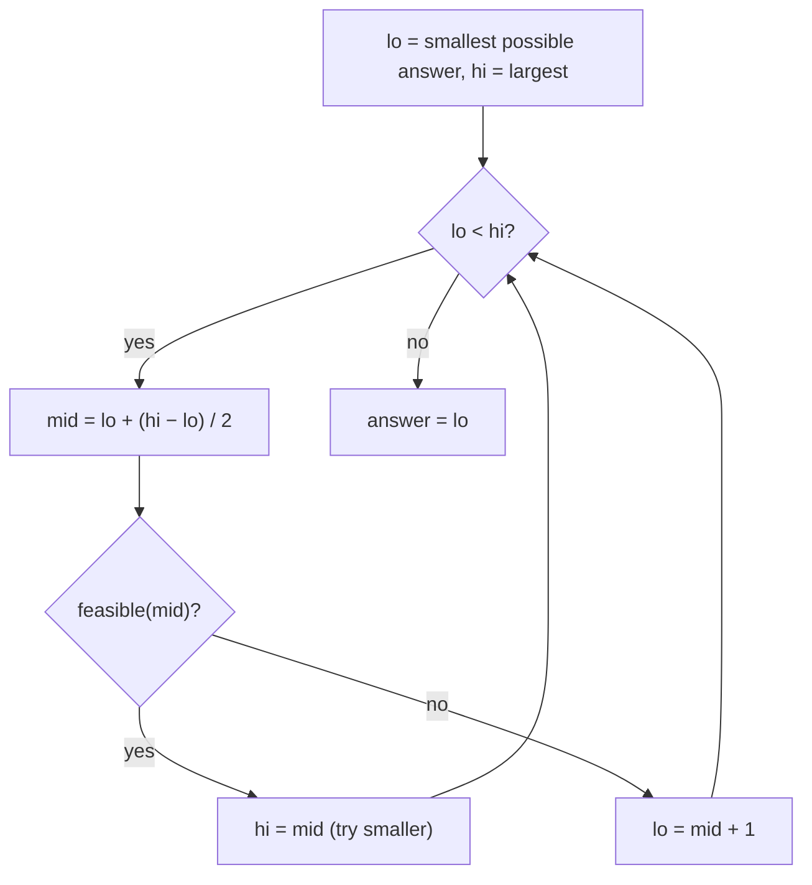
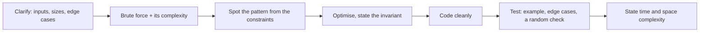

# Session 2 · More Interview Patterns and Choosing the Right One

Prepared by **Hamna Zahid Khan**, Junior Lecturer

[🏠 Course home](../README.md) · [📘 Module overview](./README.md) · [⬅ Previous](./session-01-two-pointers-and-sliding-window.md) · [Practice test ➡](./practice-test.md)

> **Module 17 · Interview Problem Patterns** · ⏱ 3 hours (90 min lecture + 90 min lab)

## 🎯 Learning objectives

1. Apply **fast/slow pointers** (Floyd's cycle detection) beyond linked lists.
2. Use **binary search on the answer** for "minimum capacity / speed / time" problems.
3. Recall the **prefix sum + hash map**, **monotonic stack**, **cyclic sort** and **bit manipulation** patterns.
4. Map problem statements to patterns using a decision guide.
5. Practise an interview routine: clarify, brute force, optimise, test, analyse.

---

## 1. The pattern catalogue

| Pattern | Signal | Course link |
|---|---|---|
| Two pointers / sliding window | sorted pairs, contiguous ranges | Session 1 |
| Fast/slow pointers | cycles, middle element, duplicate in 1..n | Module 05 |
| Binary search on the answer | "minimum X such that it is possible" | Module 03 |
| Prefix sum + hash map | subarray sum = k, negatives allowed | Module 08 |
| Monotonic stack / deque | next greater/smaller, window max | Modules 06-07 |
| Top-k / heap | k largest, k closest, merge k | Module 11 |
| Intervals | merge, overlap, rooms | Module 15 |
| BFS / DFS / topo sort | grids, graphs, dependencies | Module 12 |
| Backtracking | all combinations, puzzles | Module 14 |
| Dynamic programming | count/optimise with overlapping choices | Module 16 |
| Cyclic sort | values in 1..n, find missing/duplicate | this session |
| Bit manipulation | pairs cancel, subsets, powers of two | this session |

> 🧰 **Analogy: an electrician's toolbox.** A good electrician does not invent a new tool for each house. They look at the job ("loose socket", "tripping breaker") and reach for the right tool immediately. Interview problems are the same: the description tells you which tool to pick.

## 2. Fast/slow pointers on arrays

An array of n + 1 values in 1..n defines a function i → a[i]. Following it from index 0 is a linked list that must eventually loop, and the **duplicate value** is the entrance of the cycle.

| Phase | Movement | Result for [3, 1, 3, 4, 2] |
|---|---|---|
| 1 | slow 1 step, fast 2 steps until they meet | meet inside the cycle |
| 2 | restart slow at 0; both 1 step | meet at **3** (the duplicate) |

O(n) time, **O(1) space**, and the array is not modified (sorting or a hash set would need O(n) space or change the input).

## 3. Binary search on the answer

When the question is "what is the **minimum** capacity / speed / time such that the task is **feasible**", and feasibility is **monotone** (if capacity c works, any larger capacity works), binary-search the answer itself.



**Ship parcels within 5 days** (weights 1..10, loaded in order): capacity ranges from 10 (heaviest parcel) to 55 (everything in one day). Feasibility check = greedy day count, O(n). About log₂ 46 ≈ 6 checks find **15** (14 would need 6 days).

| Problem | Answer range | Feasibility test |
|---|---|---|
| ship within D days | [max weight, total] | greedy day count ≤ D |
| minimum marking speed | [1, max pile] | Σ ⌈pile / speed⌉ ≤ hours |
| split array into k parts minimising the largest sum | [max, total] | greedy parts ≤ k |
| aggressive cows / place routers far apart | [0, max distance] | greedy placement count ≥ k |

## 4. Recap patterns in one line each

| Pattern | Core idea | Example from the program |
|---|---|---|
| Prefix sum + hash map | two equal prefix sums ⇒ zero-sum range; first index gives the longest | longest stretch with net change 3 = 5 days |
| Monotonic stack | pop smaller elements when a bigger one arrives; popping time is their answer | days until a warmer temperature |
| Cyclic sort | value v belongs at index v − 1; swap it home | missing 5 and duplicated 1 among roll numbers |
| XOR | x ^ x = 0 and x ^ 0 = x | the unpaired value 5 |
| Bitmask subsets | bit b set ⇔ item b chosen | 8 subsets of {pen, ruler, eraser} |

## 5. An interview routine



**Constraints tell you the target complexity** (about 10⁸ simple operations per second):

| n up to | Acceptable | Typical pattern |
|---|---|---|
| 10-20 | O(2ⁿ), O(n!) for ~10 | backtracking, bitmask DP |
| 500 | O(n³) | interval DP, Floyd-Warshall |
| 5,000 | O(n²) | 2-D DP, all pairs |
| 10⁵-10⁶ | O(n log n) | sorting, heaps, binary search, segment/Fenwick trees |
| 10⁷+ | O(n) | two pointers, windows, prefix sums, hashing |

## 6. Complexity table

| Pattern | Time | Space |
|---|---|---|
| Floyd duplicate finder | O(n) | O(1) |
| Binary search on answer | O(n log(range)) | O(1) |
| Prefix sum + hash map | O(n) expected | O(n) |
| Monotonic stack | O(n) amortised | O(n) |
| Cyclic sort | O(n) | O(1) |
| XOR single number | O(n) | O(1) |
| Boyer-Moore majority vote | O(n) | O(1) |

---

## 7. Complete program

📄 **[`src/MorePatterns.java`](src/MorePatterns.java)**

```java
import java.util.ArrayDeque;
import java.util.Arrays;
import java.util.Deque;
import java.util.HashMap;
import java.util.Map;

/**
 * Session 2 demo: more interview patterns, each in a few lines. Fast/slow pointers (Floyd's cycle
 * detection on an array), binary search on the answer (minimum truck capacity), prefix sum + hash map,
 * monotonic stack (next warmer day), cyclic sort (missing and duplicate roll numbers) and bit tricks
 * (the unpaired value, subsets as bitmasks).
 *
 * Compile:  javac -d out MorePatterns.java
 * Run:      java -cp out MorePatterns
 *
 * Prepared by Hamna Zahid Khan, Junior Lecturer
 */
public class MorePatterns {

    /** a has n+1 values in 1..n, exactly one repeated (maybe many times). Treat i -> a[i] as a linked list. */
    static int findDuplicate(int[] a) {
        int slow = a[0], fast = a[a[0]];
        while (slow != fast) { slow = a[slow]; fast = a[a[fast]]; }   // phase 1: meet inside the cycle
        slow = 0;
        while (slow != fast) { slow = a[slow]; fast = a[fast]; }       // phase 2: meet at the cycle entrance
        return slow;
    }

    /** Smallest truck capacity that ships all parcels (in order) within d days. Binary search on capacity. */
    static int shipWithinDays(int[] w, int d) {
        int lo = Arrays.stream(w).max().orElse(0), hi = Arrays.stream(w).sum();
        while (lo < hi) {
            int mid = lo + (hi - lo) / 2;
            if (daysNeeded(w, mid) <= d) hi = mid;      // feasible: try smaller
            else lo = mid + 1;                          // infeasible: need more capacity
        }
        return lo;
    }

    static int daysNeeded(int[] w, int cap) {
        int days = 1, load = 0;
        for (int x : w) {
            if (load + x > cap) { days++; load = 0; }
            load += x;
        }
        return days;
    }

    /** Longest subarray with sum exactly k (negatives allowed): first index of each prefix sum. */
    static int longestSumK(int[] a, int k) {
        Map<Integer, Integer> first = new HashMap<>();
        first.put(0, -1);
        int sum = 0, best = 0;
        for (int i = 0; i < a.length; i++) {
            sum += a[i];
            Integer j = first.get(sum - k);
            if (j != null) best = Math.max(best, i - j);
            first.putIfAbsent(sum, i);
        }
        return best;
    }

    /** Days to wait for a warmer temperature: monotonic decreasing stack of indices. */
    static int[] dailyTemperatures(int[] t) {
        int[] wait = new int[t.length];
        Deque<Integer> st = new ArrayDeque<>();
        for (int i = 0; i < t.length; i++) {
            while (!st.isEmpty() && t[st.peek()] < t[i]) { int j = st.pop(); wait[j] = i - j; }
            st.push(i);
        }
        return wait;
    }

    /** Values 1..n with one missing and one duplicated: cyclic sort puts value v at index v-1. O(n), O(1) space. */
    static int[] missingAndDuplicate(int[] in) {
        int[] a = in.clone();
        int i = 0;
        while (i < a.length) {
            int target = a[i] - 1;
            if (a[i] != a[target]) { int t = a[i]; a[i] = a[target]; a[target] = t; }   // send a[i] home
            else i++;
        }
        for (int k = 0; k < a.length; k++) if (a[k] != k + 1) return new int[]{k + 1, a[k]};
        return new int[]{-1, -1};
    }

    /** Every value appears twice except one: XOR cancels pairs (x ^ x = 0). */
    static int unpaired(int[] a) {
        int x = 0;
        for (int v : a) x ^= v;
        return x;
    }

    public static void main(String[] args) {
        System.out.println("== Fast/slow pointers ==");
        int[] dup = {3, 1, 3, 4, 2};
        System.out.println("findDuplicate(" + Arrays.toString(dup) + ") = " + findDuplicate(dup) + "  (O(1) extra space, array untouched)");

        System.out.println("\n== Binary search on the answer ==");
        int[] parcels = {1, 2, 3, 4, 5, 6, 7, 8, 9, 10};
        int cap = shipWithinDays(parcels, 5);
        System.out.println("parcels " + Arrays.toString(parcels) + " in 5 days -> min capacity " + cap
                + " (days needed at " + cap + " = " + daysNeeded(parcels, cap) + ", at " + (cap - 1) + " = " + daysNeeded(parcels, cap - 1) + ")");

        System.out.println("\n== Prefix sum + hash map ==");
        int[] balance = {3, -2, 1, 4, -3, 2, -1};
        System.out.println("longest stretch of " + Arrays.toString(balance) + " with net change 3 = " + longestSumK(balance, 3) + " days");

        System.out.println("\n== Monotonic stack ==");
        int[] temps = {30, 28, 33, 31, 29, 35, 34, 36};
        System.out.println("temps " + Arrays.toString(temps) + " -> wait " + Arrays.toString(dailyTemperatures(temps)));

        System.out.println("\n== Cyclic sort ==");
        int[] rolls = {4, 3, 6, 2, 1, 1};
        int[] md = missingAndDuplicate(rolls);
        System.out.println("roll numbers " + Arrays.toString(rolls) + " -> missing " + md[0] + ", duplicated " + md[1]);

        System.out.println("\n== Bit manipulation ==");
        System.out.println("unpaired([7, 3, 5, 3, 7]) = " + unpaired(new int[]{7, 3, 5, 3, 7}));
        String[] items = {"pen", "ruler", "eraser"};
        StringBuilder sb = new StringBuilder();
        for (int mask = 0; mask < 1 << items.length; mask++) {
            StringBuilder set = new StringBuilder("{");
            for (int b = 0; b < items.length; b++) if ((mask >> b & 1) == 1) set.append(set.length() > 1 ? "," : "").append(items[b]);
            sb.append(Integer.toBinaryString(mask | 8).substring(1)).append('=').append(set).append("} ");
        }
        System.out.println("subsets as bitmasks: " + sb.toString().trim());
        System.out.println("isPowerOfTwo(64) = " + ((64 & 63) == 0) + ", bitCount(13) = " + Integer.bitCount(13) + ", lowest set bit of 12 = " + (12 & -12));
    }
}
```

**Real output:**

```text
$ java -cp out MorePatterns
== Fast/slow pointers ==
findDuplicate([3, 1, 3, 4, 2]) = 3  (O(1) extra space, array untouched)

== Binary search on the answer ==
parcels [1, 2, 3, 4, 5, 6, 7, 8, 9, 10] in 5 days -> min capacity 15 (days needed at 15 = 5, at 14 = 6)

== Prefix sum + hash map ==
longest stretch of [3, -2, 1, 4, -3, 2, -1] with net change 3 = 5 days

== Monotonic stack ==
temps [30, 28, 33, 31, 29, 35, 34, 36] -> wait [2, 1, 3, 2, 1, 2, 1, 0]

== Cyclic sort ==
roll numbers [4, 3, 6, 2, 1, 1] -> missing 5, duplicated 1

== Bit manipulation ==
unpaired([7, 3, 5, 3, 7]) = 5
subsets as bitmasks: 000={} 001={pen} 010={ruler} 011={pen,ruler} 100={eraser} 101={pen,eraser} 110={ruler,eraser} 111={pen,ruler,eraser}
isPowerOfTwo(64) = true, bitCount(13) = 3, lowest set bit of 12 = 4
```

---

## 8. Worked examples (basic → advanced)

**Example 1 (basic): majority element.** An element appears more than n/2 times. Boyer-Moore voting pairs each majority vote against a different vote; the majority survives. O(n) time, O(1) space.

```java
/** Element appearing more than n/2 times (guaranteed): Boyer-Moore voting, O(n) time, O(1) space. */
static int majority(int[] a) {
    int cand = 0, count = 0;
    for (int x : a) {
        if (count == 0) cand = x;
        count += x == cand ? 1 : -1;
    }
    return cand;
}
```
<sub>Full, compiled version: [`src/Labs17.java`](src/Labs17.java)</sub>

**Example 2 (intermediate): minimum marking speed.** A lecturer has piles of [30, 11, 23, 4, 20] answer scripts and 6 hours; at speed s she finishes a pile of p scripts in ⌈p / s⌉ hours (one pile at a time per hour). Binary search s in [1, 30].

```java
/** Slowest marking speed (papers per hour) to finish all piles within h hours. Binary search on the answer. */
static int minSpeed(int[] piles, int h) {
    int lo = 1, hi = 0;
    for (int p : piles) hi = Math.max(hi, p);
    while (lo < hi) {
        int mid = lo + (hi - lo) / 2;
        long hours = 0;
        for (int p : piles) hours += (p + mid - 1) / mid;    // ceil(p / mid)
        if (hours <= h) hi = mid; else lo = mid + 1;
    }
    return lo;
}
```
<sub>Full, compiled version: [`src/Labs17.java`](src/Labs17.java)</sub>

| lo | hi | mid | hours at mid | decision |
|---|---|---|---|---|
| 1 | 30 | 15 | 2+1+2+1+2 = 8 > 6 | lo = 16 |
| 16 | 30 | 23 | 2+1+1+1+1 = 6 ≤ 6 | hi = 23 |
| 16 | 23 | 19 | 2+1+2+1+2 = 8 | lo = 20 |
| 20 | 23 | 21 | 2+1+2+1+1 = 7 | lo = 22 |
| 22 | 23 | 22 | 2+1+2+1+1 = 7 | lo = 23 ⇒ **23** |

**Example 3 (advanced): search in a rotated sorted array.** [40, 50, 60, 10, 20, 30] was sorted then rotated. At every step one half is sorted; check whether the target lies in that half's range, otherwise search the other half. Still O(log n).

```java
/** Search in a rotated sorted array: one half is always sorted; check whether the target lies in it. */
static int searchRotated(int[] a, int target) {
    int lo = 0, hi = a.length - 1;
    while (lo <= hi) {
        int mid = (lo + hi) >>> 1;
        if (a[mid] == target) return mid;
        if (a[lo] <= a[mid]) {                                // left half sorted
            if (a[lo] <= target && target < a[mid]) hi = mid - 1; else lo = mid + 1;
        } else {                                              // right half sorted
            if (a[mid] < target && target <= a[hi]) lo = mid + 1; else hi = mid - 1;
        }
    }
    return -1;
}
```
<sub>Full, compiled version: [`src/Labs17.java`](src/Labs17.java)</sub>

## 9. Real-life problem: sizing the exam-paper courier van

**Problem.** After exams, 40 sealed bundles of answer scripts (known weights, fixed order by department) must be moved to the evaluation centre within 4 trips. The transport office wants the **smallest** van (capacity in kg) that makes this possible, to save rental cost.

**Solution.** This is "ship within D days": binary search the capacity between the heaviest bundle and the total weight; for each candidate, greedily count trips (start a new trip when the next bundle does not fit). Feasibility is monotone, so the first feasible capacity is the answer. 40 bundles × about 15 checks = 600 steps, compared with trying every capacity one kilogram at a time.

## 10. Common mistakes

| Mistake | Fix |
|---|---|
| Binary search on the answer with a non-monotone test | prove "if c works, c + 1 works" first |
| `mid = (lo + hi) / 2` overflowing for large ranges | `lo + (hi − lo) / 2` |
| Wrong lower bound (e.g. capacity 1 when a parcel weighs 10) | start at the smallest **possible** answer |
| Cyclic sort loop advancing `i` after every swap | only advance when a[i] is home or a duplicate |
| Applying XOR tricks when values appear 3 times | needs bit counting per position |
| Jumping to code without stating complexity targets | read the constraints first |

## 11. Best practices

- Keep a personal pattern sheet (this module's README) and add each new problem under its pattern.
- Always have a brute-force checker for random tests, exactly like the `SelfCheck` files in this course.
- Explain the invariant before coding; interviewers grade reasoning as much as code.
- Prefer clear names (`left`, `right`, `need`, `missing`) over single letters in interviews.

---

## 12. Lab tasks

**Lab 2.1: Minimum marking speed.**

<details>
<summary>✅ Solution</summary>

See Example 2.

</details>

**Lab 2.2: Search in a rotated array.**

<details>
<summary>✅ Solution</summary>

See Example 3.

</details>

**Lab 2.3: Majority element.**

<details>
<summary>✅ Solution</summary>

See Example 1.

</details>

**Lab 2.4: Pattern matching drill.** Name the pattern for each: (a) longest substring with at most 2 distinct characters; (b) number of subarrays with sum exactly k, negatives allowed; (c) the smallest maximum page load when splitting chapters among k students; (d) next greater element for each value; (e) all ways to place k rooks safely.

<details>
<summary>✅ Solution</summary>

(a) variable sliding window; (b) prefix sum + hash map; (c) binary search on the answer with greedy feasibility; (d) monotonic stack; (e) backtracking.

</details>

**Real output of the Session 2 lab solutions:**

```text
$ java -cp out Labs17 2
-- Session 2 labs --
minSpeed([30, 11, 23, 4, 20], h=6) = 23
searchRotated([40, 50, 60, 10, 20, 30], 20) = 4, (…, 45) = -1
majority([2, 2, 1, 1, 1, 2, 2]) = 2
```

---

## 13. Quiz

**Q1.** Floyd's cycle detection finds a duplicate in an array of n+1 values in 1..n using:

- **A.** O(n) extra space
- **B.** O(1) extra space
- **C.** sorting
- **D.** a hash map

**Q2.** Binary search on the answer requires the feasibility test to be:

- **A.** random
- **B.** monotone
- **C.** O(1)
- **D.** recursive

**Q3.** Counting subarrays with sum k when negatives are allowed uses:

- **A.** a sliding window
- **B.** prefix sums + a hash map
- **C.** two pointers
- **D.** a heap

**Q4.** "Next greater element" is solved in O(n) with:

- **A.** a queue
- **B.** a monotonic stack
- **C.** binary search
- **D.** DP

**Q5.** For n up to 10⁵, a solution should usually be at most:

- **A.** O(n³)
- **B.** O(n²)
- **C.** O(n log n)
- **D.** O(2ⁿ)

<details>
<summary><b>Show answers</b></summary>

1. **B**: Treat the array as a linked list.
2. **B**: If c works, every larger c works.
3. **B**: Windows need monotonic sums.
4. **B**: Each element is pushed and popped once.
5. **C**: About 10⁸ operations per second.

</details>

---

## 14. Summary

- Fast/slow pointers find cycles and duplicates in O(1) space.
- Binary search on the answer turns "minimum feasible X" into O(n log range).
- Prefix sums + hashing, monotonic stacks, cyclic sort and XOR each solve a family of problems in O(n).
- Constraints reveal the target complexity; the problem wording reveals the pattern.

## 15. Viva / interview questions

1. Why is the duplicate value the entrance of the cycle in Floyd's method?
2. Prove that "ship within D days" feasibility is monotone in capacity.
3. Find the single number when every other number appears three times.
4. Explain Boyer-Moore voting and how to verify the candidate if a majority is not guaranteed.
5. Given n ≤ 2 × 10⁵, which patterns are ruled out and why?
6. Walk through your full interview routine on "longest substring with at most k distinct characters".

---

[⬅ Previous](./session-01-two-pointers-and-sliding-window.md) · [📘 Module overview](./README.md) · [Practice test ➡](./practice-test.md)
