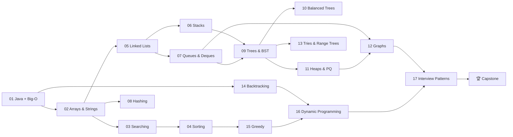

<p align="center"></p>

# Data Structures and Algorithms in Java

Prepared by **Hamna Zahid Khan**, Junior Lecturer

A complete, university-level course in **Data Structures and Algorithms using Java 17**. Every session is a self-contained lecture note with analogies, Mermaid diagrams, step-by-step dry runs, complexity tables, worked examples, a real-life problem, common mistakes, lab tasks with hidden solutions, a quiz and viva questions, backed by **real, compiled and tested Java programs** whose actual output is pasted into the notes.

> 🚧 **2 of 18 parts published.** Modules are released in order; the rest are marked *coming soon* below.

   

## 🧭 Course roadmap



## 📚 Table of contents

### [Module 01 · Java Refresher and Complexity](01-java-refresher-and-complexity/README.md)

1. [Java Refresher for Data Structures](01-java-refresher-and-complexity/session-01-java-refresher-for-dsa.md)
2. [Asymptotic Analysis and Big-O](01-java-refresher-and-complexity/session-02-asymptotic-analysis-big-o.md)
3. [Recursion Fundamentals](01-java-refresher-and-complexity/session-03-recursion-fundamentals.md)
- ✍️ [Practice test](01-java-refresher-and-complexity/practice-test.md) · 💻 [Source code](01-java-refresher-and-complexity/src/README.md)

### [Module 02 · Arrays and Strings](02-arrays-and-strings/README.md)

1. [Arrays and Dynamic Arrays](02-arrays-and-strings/session-01-arrays-and-dynamic-arrays.md)
2. [Two-Dimensional Arrays and Matrices](02-arrays-and-strings/session-02-two-dimensional-arrays-and-matrices.md)
3. [Strings and Pattern Matching](02-arrays-and-strings/session-03-strings-and-pattern-matching.md)
- ✍️ [Practice test](02-arrays-and-strings/practice-test.md) · 💻 [Source code](02-arrays-and-strings/src/README.md)

### Module 03 · Searching · ⏳ *coming soon*

### Module 04 · Sorting · ⏳ *coming soon*

### Module 05 · Linked Lists · ⏳ *coming soon*

### Module 06 · Stacks · ⏳ *coming soon*

### Module 07 · Queues and Deques · ⏳ *coming soon*

### Module 08 · Hashing · ⏳ *coming soon*

### Module 09 · Trees and Binary Search Trees · ⏳ *coming soon*

### Module 10 · Balanced Trees (AVL, Red-Black) · ⏳ *coming soon*

### Module 11 · Heaps and Priority Queues · ⏳ *coming soon*

### Module 12 · Graphs · ⏳ *coming soon*

### Module 13 · Tries, Segment Trees and Fenwick Trees · ⏳ *coming soon*

### Module 14 · Recursion and Backtracking · ⏳ *coming soon*

### Module 15 · Greedy Algorithms · ⏳ *coming soon*

### Module 16 · Dynamic Programming · ⏳ *coming soon*

### Module 17 · Interview Problem Patterns · ⏳ *coming soon*

### 🏆 Capstone Projects · ⏳ *coming soon*

## 🧱 How each module is organised

```text
NN-module-name/
├── README.md              objectives, session list, concept map, one-page cheat sheet
├── session-NN-*.md        lecture notes (theory, dry runs, code + real output, labs, quiz, viva)
├── practice-test.md       20 MCQs + 3 coding scenarios (answers hidden in <details>)
└── src/
    ├── README.md          every file, what it does, how to run it
    ├── *.java             one complete program per topic, each with a main() demo
    ├── LabsNN.java        compiled reference solutions for all lab tasks
    └── SelfCheck.java     JUnit-free tests for the whole module
```

## ▶️ How to compile and run

You only need a **JDK 17 or newer** (check with `java -version`). No build tool and no libraries.

```bash
git clone https://github.com/Hamnakhan123/Data-Structure-and-Algorithms.git
cd Data-Structure-and-Algorithms/01-java-refresher-and-complexity/src

javac -d out *.java            # compile all files of a module into ./out
java -ea -cp out SelfCheck      # run the module's tests (-ea enables assertions)
java -cp out RecursionBasics    # run any demo by its class name
```

All programs use the **default package**, so every module compiles independently with the same two commands. In an IDE (IntelliJ IDEA, Eclipse, VS Code), open a module's `src/` folder as a source root and run any class with a `main` method.

## ⚡ Big-O cheat sheet

**Data structures (average / worst)**

| Structure | Access | Search | Insert | Delete | Space |
|---|---|---|---|---|---|
| Array | O(1) | O(n) | O(n) | O(n) | O(n) |
| Dynamic array (`ArrayList`) | O(1) | O(n) | O(1)* end / O(n) | O(n) | O(n) |
| Singly linked list | O(n) | O(n) | O(1) at head | O(1) at head | O(n) |
| Doubly linked list | O(n) | O(n) | O(1) with node | O(1) with node | O(n) |
| Stack / Queue / Deque | – | O(n) | O(1) | O(1) | O(n) |
| Hash table | – | O(1) / O(n) | O(1) / O(n) | O(1) / O(n) | O(n) |
| Binary search tree | O(log n) / O(n) | O(log n) / O(n) | O(log n) / O(n) | O(log n) / O(n) | O(n) |
| AVL / Red-black tree | O(log n) | O(log n) | O(log n) | O(log n) | O(n) |
| Binary heap | O(1) top | O(n) | O(log n) | O(log n) top | O(n) |
| Trie | – | O(L) | O(L) | O(L) | O(Σ·N·L) |
| Segment / Fenwick tree | – | O(log n) query | O(log n) update | – | O(n) |

\* amortised. L = key length.

**Sorting**

| Algorithm | Best | Average | Worst | Space | Stable |
|---|---|---|---|---|---|
| Bubble | O(n) | O(n²) | O(n²) | O(1) | ✅ |
| Selection | O(n²) | O(n²) | O(n²) | O(1) | ❌ |
| Insertion | O(n) | O(n²) | O(n²) | O(1) | ✅ |
| Merge | O(n log n) | O(n log n) | O(n log n) | O(n) | ✅ |
| Quick | O(n log n) | O(n log n) | O(n²) | O(log n) | ❌ |
| Heap | O(n log n) | O(n log n) | O(n log n) | O(1) | ❌ |
| Counting | O(n + k) | O(n + k) | O(n + k) | O(k) | ✅ |
| Radix | O(d(n + b)) | O(d(n + b)) | O(d(n + b)) | O(n + b) | ✅ |

**Graphs** (V vertices, E edges)

| Algorithm | Time | Use |
|---|---|---|
| BFS / DFS | O(V + E) | reachability, unweighted shortest path, components |
| Topological sort | O(V + E) | ordering a DAG |
| Dijkstra (binary heap) | O((V + E) log V) | shortest paths, non-negative weights |
| Bellman–Ford | O(V·E) | negative weights, cycle detection |
| Prim (heap) / Kruskal | O(E log V) / O(E log E) | minimum spanning tree |
| Union–Find (rank + compression) | ≈ O(1) amortised | dynamic connectivity |

## ✅ Progress checklist

Copy this list into your notes and tick modules off as you finish them:

- [ ] Module 01 · Java Refresher and Complexity
- [ ] Module 02 · Arrays and Strings
- [ ] Module 03 · Searching *(coming soon)*
- [ ] Module 04 · Sorting *(coming soon)*
- [ ] Module 05 · Linked Lists *(coming soon)*
- [ ] Module 06 · Stacks *(coming soon)*
- [ ] Module 07 · Queues and Deques *(coming soon)*
- [ ] Module 08 · Hashing *(coming soon)*
- [ ] Module 09 · Trees and Binary Search Trees *(coming soon)*
- [ ] Module 10 · Balanced Trees (AVL, Red-Black) *(coming soon)*
- [ ] Module 11 · Heaps and Priority Queues *(coming soon)*
- [ ] Module 12 · Graphs *(coming soon)*
- [ ] Module 13 · Tries, Segment Trees and Fenwick Trees *(coming soon)*
- [ ] Module 14 · Recursion and Backtracking *(coming soon)*
- [ ] Module 15 · Greedy Algorithms *(coming soon)*
- [ ] Module 16 · Dynamic Programming *(coming soon)*
- [ ] Module 17 · Interview Problem Patterns *(coming soon)*
- [ ] 🏆 Capstone Projects *(coming soon)*

## 📝 Suggested study routine

1. Read the session notes and **predict the output** before looking at it.
2. Compile and run the session's program; change inputs and observe.
3. Attempt every lab task **before** opening the hidden solution.
4. Answer the quiz and viva questions out loud.
5. Finish the module with its practice test and `SelfCheck`.

---

<sub>Prepared by **Hamna Zahid Khan**, Junior Lecturer · All code and notes are original teaching material.</sub>
