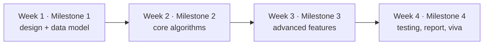

# 🏆 Capstone Projects

Prepared by **Hamna Zahid Khan**, Junior Lecturer

[🏠 Course home](../README.md)

> ⏱ 4 weeks · teams of 2-3 · choose **one** of three projects

The capstone pulls the whole course together. Each project is a small but realistic system in plain Java 17 that needs several data structures working together, has a clear milestone plan, and comes with **compiling starter code** plus a checks program that reports which features are finished.

## 🎯 Capstone outcomes

- Choose data structures and algorithms by their complexity and justify the choice in writing.
- Combine at least four course topics (hashing, trees, heaps, graphs, tries, DP, backtracking, greedy) in one program.
- Work in milestones with version control, tests and a short technical report.
- Present and defend design decisions in a viva.

## 📚 The three projects

| # | Project | Core topics | Starter code |
|---|---|---|---|
| 1 | [Campus Navigator](project-01-campus-navigator.md) | graphs (BFS, Dijkstra, Kruskal), union-find, hashing, tries | [`CampusNavigator.java`](project-01-campus-navigator/src/CampusNavigator.java), [`NavigatorChecks.java`](project-01-campus-navigator/src/NavigatorChecks.java) |
| 2 | [Library Search Engine](project-02-library-search-engine.md) | inverted index (hashing), heaps (top-k), tries, edit-distance DP, LRU cache | [`LibrarySearch.java`](project-02-library-search-engine/src/LibrarySearch.java), [`SearchChecks.java`](project-02-library-search-engine/src/SearchChecks.java) |
| 3 | [Exam Timetable Planner](project-03-exam-timetable-planner.md) | graph colouring (backtracking), topological sort, heaps, greedy | [`TimetablePlanner.java`](project-03-exam-timetable-planner/src/TimetablePlanner.java), [`PlannerChecks.java`](project-03-exam-timetable-planner/src/PlannerChecks.java) |



## 🗓️ Milestones (all projects)

| Milestone | Week | Deliverable | Evidence |
|---|---|---|---|
| **M1 · Design** | 1 | one-page design: features, data structures chosen and why, complexity of each operation | design doc + starter code runs |
| **M2 · Core** | 2 | core algorithms implemented; first checks pass | checks output, commit history |
| **M3 · Advanced** | 3 | all features in the brief; all checks pass | checks output `n/n features complete` |
| **M4 · Quality** | 4 | your own test class (random tests vs brute force), a 3-4 page report with a complexity table and one measured experiment, a 10-minute demo | report, tests, viva |

## 📏 Grading rubric (100 marks)

| Criterion | Marks | Excellent (full marks) |
|---|---|---|
| Correctness | 30 | all checks pass; extra tests including edge cases and random brute-force comparisons |
| Choice of data structures | 20 | every choice justified with complexity; alternatives discussed |
| Code quality | 15 | small methods, clear names, comments that explain *why*, compiles with `-Xlint:all -Werror` |
| Testing | 10 | a `Tests` class with at least 10 checks, including random tests |
| Report and experiment | 15 | complexity table + one timed experiment (e.g. Dijkstra vs BFS, trie vs scanning) with a chart or table |
| Viva and teamwork | 10 | every member can explain any part of the code; commit history shows shared work |

## ▶️ Getting started

```bash
cd capstone/project-01-campus-navigator/src     # or project-02 / project-03
javac -d out *.java
java -ea -cp out NavigatorChecks                 # SearchChecks / PlannerChecks for the others
```

Every starter method compiles and returns a placeholder, so the checks print `[todo]` until you implement it. Do **not** change the checks' expected values; add your own tests in a separate class.

## ✅ Rules

- Plain Java 17, default package, no external libraries; `java.util` collections are allowed **except** where the brief says "implement yourself".
- Keep the code compiling at every commit.
- Cite any outside help (books, websites, classmates) in the report. Copied code without citation scores zero for that part.
