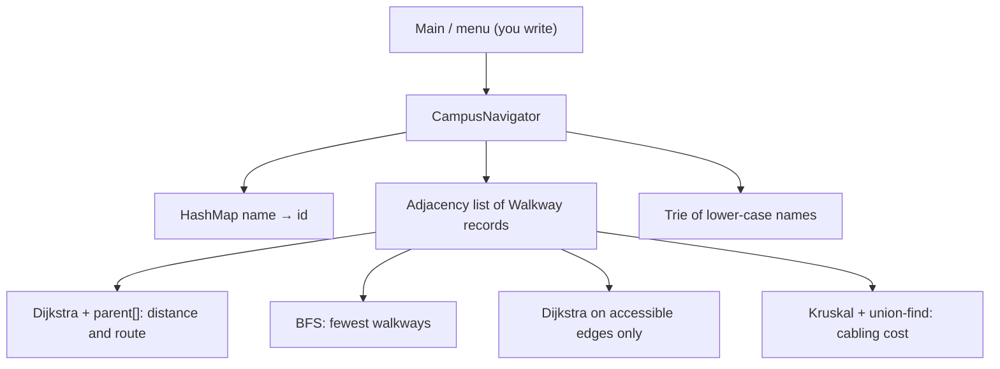

# Capstone 1 · Campus Navigator

Prepared by **Hamna Zahid Khan**, Junior Lecturer

[🏠 Course home](../README.md) · [🏆 Capstone overview](./README.md)

> Graphs · Dijkstra · BFS · Kruskal + union-find · hashing · tries

## 📌 The brief

New students get lost on campus, and students using wheelchairs need routes without stairs. Build a **command-line campus navigator** that loads a map of places and walkways and answers:

1. the **shortest walking route** between two places (metres and the list of places);
2. the route with the **fewest walkways** (simplest to explain to a visitor);
3. the shortest **step-free** route using only accessible walkways;
4. **autocomplete** of place names as the user types;
5. the **minimum total cable** needed to connect every building with fibre (for the IT office).

> 🗺️ **Real-life context.** Campus apps, hospital way-finding kiosks and indoor mall maps all solve these exact problems on graphs with a few hundred to a few thousand nodes.

## 🏗️ Architecture



| Feature | Data structure / algorithm | Target complexity | Module |
|---|---|---|---|
| name → id lookup | `HashMap` | O(1) expected | 08 |
| shortest route | Dijkstra with `PriorityQueue`, parent array | O((V + E) log V) | 12 |
| fewest walkways | BFS | O(V + E) | 12 |
| step-free route | Dijkstra filtering edges | O((V + E) log V) | 12 |
| autocomplete | trie (implement yourself) | O(L + results) | 13 |
| cabling cost | Kruskal + union-find (implement yourself) | O(E log E) | 12 |

## 🗓️ Milestones

| Milestone | Tasks |
|---|---|
| **M1 · Design** | Draw your campus (at least 25 places, 40 walkways, some not accessible) and load it with `addPlace`/`addWalkway` or from a CSV file. Write the design page. |
| **M2 · Core** | Implement `shortestDistance`, `shortestRoute`, `fewestWalkways`. Checks 1-3 pass. |
| **M3 · Advanced** | Implement `accessibleDistance`, `suggest`, `cablingCost`. All 6 checks pass. Add a text menu: route, accessible route, suggest, cabling. |
| **M4 · Quality** | `NavigatorTests` with random graphs: Dijkstra vs Floyd-Warshall, BFS vs Dijkstra on unit weights, Kruskal vs Prim totals. Report + experiment: time Dijkstra on random graphs with 10³-10⁵ vertices and plot against (V + E) log V. |

## 💻 Starter code

📄 [`src/CampusNavigator.java`](project-01-campus-navigator/src/CampusNavigator.java) · 📄 [`src/NavigatorChecks.java`](project-01-campus-navigator/src/NavigatorChecks.java)

The sample map:

| Walkway | Metres | Accessible |
|---|---|---|
| Main Gate - Library | 120 | ✔ |
| Main Gate - Admin | 80 | ✔ |
| Library - Cafeteria | 60 | ✘ (stairs) |
| Library - CS Block | 90 | ✔ |
| Cafeteria - CS Block | 40 | ✔ |
| CS Block - Labs | 70 | ✘ |
| Admin - Labs | 150 | ✔ |
| Labs - Hostel | 200 | ✔ |
| Hostel - Sports Complex | 110 | ✔ |

**Real output of the starter code (nothing implemented yet):**

```text
$ java -ea -cp out NavigatorChecks
Campus Navigator: 8 places loaded
[todo] shortestDistance(Main Gate, Labs) = 230
[todo] shortestRoute(Main Gate, Labs) = [Main Gate, Admin, Labs]
[todo] fewestWalkways(Main Gate, Cafeteria) = 2
[todo] accessibleDistance(Main Gate, Cafeteria) = 250
[todo] suggest("c") = [Cafeteria, CS Block]
[todo] cablingCost() = 680
0/6 features complete
```

When you finish Milestone 3 the last line must read `6/6 features complete`.

## 💡 Hints

<details>
<summary>Dijkstra with a route</summary>

Use `long[] dist`, `int[] parent` and a `PriorityQueue<long[]>` of `{distance, vertex}` with lazy deletion (skip a popped vertex whose distance is outdated). Rebuild the route by following `parent` from the target and reversing. See Module 12, Session 3.

</details>

<details>
<summary>Accessible routes without duplicating code</summary>

Write one private `dijkstra(int source, java.util.function.Predicate<Walkway> allowed)` and call it with `w -> true` or `Walkway::accessible`.

</details>

<details>
<summary>Case-insensitive autocomplete that returns original names</summary>

Insert `name.toLowerCase()` into the trie but store the original name at the word's end node (e.g. a `String original` field). Collect with DFS in child order for alphabetical output.

</details>

## 🚀 Extension ideas (for distinction)

- A* search with straight-line distance as the heuristic (store coordinates per place).
- "Avoid the Cafeteria at lunchtime": temporarily raise edge weights and recompute.
- Export the route as a Mermaid diagram for the report.
