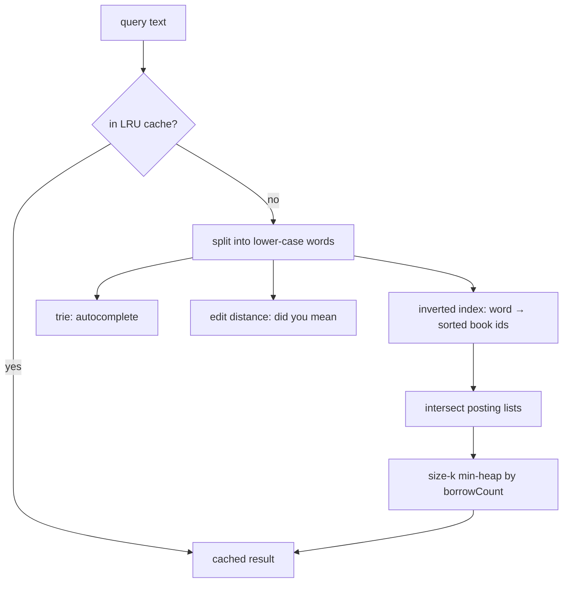

# Capstone 2 · Library Search Engine

Prepared by **Hamna Zahid Khan**, Junior Lecturer

[🏠 Course home](../README.md) · [🏆 Capstone overview](./README.md)

> Hashing · inverted index · heaps (top-k) · tries · edit-distance DP · LRU cache

## 📌 The brief

The university library's catalogue search only matches exact titles. Build a **search engine** for the catalogue that:

1. finds books containing **all** query words (any order, any case);
2. ranks matches and returns the **top k** by popularity (borrow count);
3. **autocompletes** words as the user types;
4. suggests a correction for a **misspelt** word ("did you mean …?");
5. **caches** recent queries so repeated searches are instant.

> 🔎 **Real-life context.** Every search box, from online shops to code editors, combines an inverted index, a ranking heap, prefix suggestions and typo tolerance. Large engines add distributed storage, but the core structures are the ones in this course.

## 🏗️ Architecture



| Feature | Data structure / algorithm | Target complexity | Module |
|---|---|---|---|
| inverted index | `HashMap<String, List<Integer>>` | build O(total words) | 08 |
| multi-word search | merge-style intersection of sorted lists | O(sum of list lengths) | 02, 08 |
| top-k ranking | size-k min-heap | O(m log k) | 11 |
| autocomplete | trie (implement yourself) | O(L + results) | 13 |
| did you mean | edit-distance DP (implement yourself) | O(W · L²) | 16 |
| query cache | LRU (`LinkedHashMap` access order, or your own) | O(1) | 08 |

## 🗓️ Milestones

| Milestone | Tasks |
|---|---|
| **M1 · Design** | Collect at least 200 real book titles (your department's reading lists) with made-up borrow counts; load them from a CSV file. Design page with complexity table. |
| **M2 · Core** | `buildIndex`, `search`, `topK`. Checks 1-2 pass. |
| **M3 · Advanced** | `autocomplete`, `didYouMean`, LRU cache with hit counter. All 5 checks pass. Add a text menu. |
| **M4 · Quality** | `SearchTests` comparing `search` against a brute-force scan on random queries; experiment: time 10,000 queries with and without the index for 200 / 2,000 / 20,000 titles (generate synthetic titles). |

## 💻 Starter code

📄 [`src/LibrarySearch.java`](project-02-library-search-engine/src/LibrarySearch.java) · 📄 [`src/SearchChecks.java`](project-02-library-search-engine/src/SearchChecks.java)

Sample catalogue (id, title, borrow count): 0 *Introduction to Algorithms* 95 · 1 *Algorithms in Java* 60 · 2 *Data Structures and Algorithms in Java* 120 · 3 *Java: The Complete Reference* 80 · 4 *Clean Code* 70 · 5 *Database System Concepts* 50 · 6 *Artificial Intelligence: A Modern Approach* 90 · 7 *Data Science from Scratch* 40.

**Real output of the starter code (nothing implemented yet):**

```text
$ java -ea -cp out SearchChecks
Library Search Engine: 8 books, words of book 2 = [data, structures, and, algorithms, in, java]
[todo] search("algorithms java") = [1, 2]
[todo] topK("algorithms", 2) = [Data Structures and Algorithms in Java, Introduction to Algorithms]
[todo] autocomplete("da", 5) = [data, database]
[todo] didYouMean("algoritms") = algorithms
[todo] cacheHits() >= 0 after repeated queries
0/5 features complete
```

When you finish Milestone 3 the last line must read `5/5 features complete`.

## 💡 Hints

<details>
<summary>Intersecting posting lists</summary>

If every list is sorted (ids are added in increasing order), intersect two lists with two pointers in O(a + b), like the merge step of merge sort. Start with the **shortest** list to keep intermediate results small.

</details>

<details>
<summary>Top-k with ties</summary>

Use a comparator "worse first": lower borrow count first, then **higher** id first. Keep the heap at size k, then poll into an array from the back.

</details>

<details>
<summary>Faster "did you mean"</summary>

Skip words whose length differs from the query by more than your best distance so far; most of the dictionary is pruned before any DP table is filled.

</details>

## 🚀 Extension ideas (for distinction)

- Rank by TF-IDF instead of borrow count.
- Phrase search ("data structures" as adjacent words) by storing word positions.
- Persist the index to a file and reload it.
