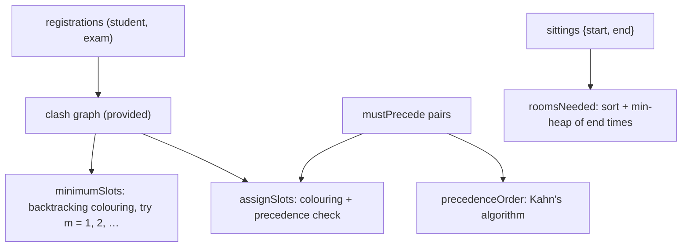

# Capstone 3 · Exam Timetable Planner

Prepared by **Hamna Zahid Khan**, Junior Lecturer

[🏠 Course home](../README.md) · [🏆 Capstone overview](./README.md)

> Graph colouring (backtracking) · topological sort · heaps · greedy

## 📌 The brief

Every semester the examination office builds the final-exam timetable by hand, and clashes slip through. Build a **timetable planner** that reads exams and student registrations and:

1. builds the **clash graph** (two exams clash if any student takes both; provided);
2. finds the **minimum number of time slots** with no student clash;
3. assigns slots that also respect **precedence** rules ("Math before AI");
4. computes how many **rooms** a day's sittings need;
5. reports a valid **order** of exams under the precedence rules, or the cycle that makes it impossible.

> 🗓️ **Real-life context.** Universities, conference organisers and compilers (register allocation) all solve graph-colouring problems. Exact colouring is NP-hard, so real tools combine backtracking with good ordering heuristics on top of the exact search you will write.

## 🏗️ Architecture



| Feature | Data structure / algorithm | Target complexity | Module |
|---|---|---|---|
| clash graph | `HashMap` student → exams, boolean matrix | O(Σ exams per student²) | 08, 12 |
| minimum slots | backtracking colouring with MRV ordering | exponential worst case, fast in practice | 14 |
| slots + precedence | backtracking with an extra constraint | as above | 14 |
| rooms | sort by start + min-heap of end times | O(n log n) | 11, 15 |
| precedence order | Kahn's algorithm, cycle report | O(V + E) | 12 |

## 🗓️ Milestones

| Milestone | Tasks |
|---|---|
| **M1 · Design** | Create realistic data: at least 20 exams and 300 registrations (generate students taking 4-6 courses each). Write the design page and draw the clash graph of a small subset. |
| **M2 · Core** | `minimumSlots`, `assignSlots`. Checks 1-2 pass. Print the timetable by slot. |
| **M3 · Advanced** | `roomsNeeded`, `precedenceOrder` (and print the cycle when one exists). All 4 checks pass. Add a "no student has more than 2 exams per day" rule (3 slots per day). |
| **M4 · Quality** | `PlannerTests`: verify every produced timetable has no clashes on random data; compare your backtracking slot count with a greedy (Welsh-Powell) colouring. Experiment: how running time grows with the number of exams (10 → 40). |

## 💻 Starter code

📄 [`src/TimetablePlanner.java`](project-03-exam-timetable-planner/src/TimetablePlanner.java) · 📄 [`src/PlannerChecks.java`](project-03-exam-timetable-planner/src/PlannerChecks.java)

Sample data: DSA (120 students), OOP (90), AI (60), DB (80), Math (150); six students whose registrations create six clashing pairs, including the triangle DSA-OOP-AI (so at least 3 slots are needed); Math must come before AI.

**Real output of the starter code (nothing implemented yet):**

```text
$ java -ea -cp out PlannerChecks
Exam Timetable Planner: 5 exams, 6 clashing pairs
[todo] minimumSlots() = 3
[todo] assignSlots() has no clashes and Math before AI
[todo] roomsNeeded([[540,660],[600,720],[660,780],[720,840]]) = 2
[todo] precedenceOrder() lists all 5 exams with Math before AI
0/4 features complete
```

When you finish Milestone 3 the last line must read `4/4 features complete`.

## 💡 Hints

<details>
<summary>Minimum slots</summary>

Write `boolean colour(int v, int m, int[] slot)` that tries slots 1..m for exam v, skipping any slot used by a clashing exam already assigned, and recurses to v + 1. Call it for m = 1, 2, 3, … and return the first m that succeeds. Order exams by **decreasing number of clashes** first: it fails faster (Module 14, Session 2).

</details>

<details>
<summary>Precedence inside the colouring</summary>

When assigning exam v, also reject slot s if some already-assigned exam u with (u, v) in `mustPrecede` has slot ≥ s, or (v, u) has slot ≤ s.

</details>

<details>
<summary>Reporting a precedence cycle</summary>

If Kahn's algorithm processes fewer than n exams, run a three-colour DFS (Module 12, Session 2) on the remaining ones to print the cycle, e.g. "AI → Math → AI".

</details>

## 🚀 Extension ideas (for distinction)

- Minimise the number of students with two exams on the same day (local search after colouring).
- Assign rooms with capacities (largest exams to largest rooms, greedy) and report overflow.
- Export the timetable as a Markdown table or CSV for the examination office.
